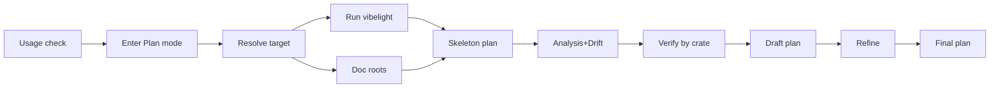

# vibelight one-time tool

Change one file: [vibelight/tools/vibelight.md](vibelight/tools/vibelight.md). The analysis, drift, verify, and refine pipeline stays, along with its shell merges into `findings.md` and `verified.md` and the Cleanup Plan template.

What's new:
- The tool enters Plan mode first.
- The scope lives in a `<scope-context>` block inside a small skeleton plan, not in a `scope.md` file.
- Every subagent pulls that block out with the same exactly-two-matches grep that [tools-public/planning/debt-collector.md](tools-public/planning/debt-collector.md) uses for its instructions.

## The finished vibelight upgrades

The output-improvements plan ran as `fea0af6` through `7702cd1`, and its Outcome section is in [vibelight/plans/2026-10-26-output-analysis-upgrades.plan.md](vibelight/plans/2026-10-26-output-analysis-upgrades.plan.md). What this plan now relies on:

- **`--members name|impl`** (`86f3b07`). `impl` prints each type's functions per inherent impl, in source order, under `// impl in <file>` lines. No profile turns it on.
- **A `Fields:` list under `--facts`** (`ccdd750`, which replaced the `Clusters:` line).
  - It appears for a type with 8 or more functions: each field, in declared order, with the functions that reach it through `self`. A hub field that more than half of them reach shows only a count.
  - On `Scheduler` it shows the effect table and the task arena directly.
- **`// internal` and `// private` lines** above non-public type headers, plus a Legend line saying a module that holds only impls shows only its docs (`f2eccd6`).
- **Unconnected counts type names in function bodies**, except bodies inside an impl whose header names the type (`52e72ad`). That makes Unconnected a stronger lead for unused types.
- **Declared field order, `where` clauses one predicate per line, and packed re-export lines** (`0489f46`, `fea0af6`, `c4ce835`).
- **The binary.** `target/release` was built before these commits and its `--help` lacks `--members`. `target/debug` has it. The qualification rule below skips the stale release, and the Verification section rebuilds release so the first pick is current.



## What goes

- **The Setup section.** That means writing `vibelight.toml`, the ignore entries, the `AGENTS.md` lines, and the CI step. Two of its parts move into the new sections: the rule for finding the binary, and the rules for excluding crates.
- **The Ledger section** and `vibelight/.scanned.md`, along with stamps, commit diffs, and the `new`, `changed`, and `forced` statuses.
- **The `setup`, `scan`, `scan all`, `scan <crates>`, and `mark` commands.**
- **The old Plan-mode wording:** step 4, the paragraph that starts "A session that starts in Plan mode compares read-only...", and "If the host has none, continue and deliver the plan as **output**."
- **`scope.md`, and the `Scope:` and `Doc roots:` template fields.** The `<scope-context>` block holds both.
- **The last step** "Update the ledger with the current stamp and HEAD."

## New flow

1. **Usage** (replaces Commands). An empty request or `help` prints the help and stops, before Plan mode. Any other request is the target plus preferences. New help text:

```text
vibelight.md: outlines Rust crates with vibelight and plans away their slop

  <target> [preferences]   analyze the crates the target names and write a Cleanup Plan
  help                     print this help

  target: crate paths, package names, globs, a repository, or a description
  examples: "crates/runvil-internal/engine"   "everything that ships in runvil, docs in ../runvil-docs"
```

2. **Plan Mode** (a new section, in debt-collector's words). "Announce your presence without asking questions. Enter Plan mode through whatever host mechanism is available before analysis. If already in Plan mode, proceed. If no mechanism exists or the switch fails, state the reason in one sentence and stop."
   - Add one sentence: in Plan mode, the shell still builds and runs vibelight and merges scratch files, as debt-collector builds its commit log there.
   - The tool writes nothing inside the analyzed repository and never commits.

3. **Resolve.** This is unchanged from the previous version of this plan:
   - Map the target to crates through their manifests.
   - Crates you name are never excluded.
   - A repository or description means every crate that ships, minus the development-support crates, using the exclusion rules from Setup's Config paragraph.
   - For each target crate, record its directory and expected outline names: the library name with underscores, each binary's name, and `<name>.bin` for a binary that shares the library's name.
   - State what resolved, stop on what doesn't, and never ask through a question tool.

4. **Outline.** Find vibelight with the existing rule: PATH, then `target/release` and `target/debug` of the checkout that holds this tool, then `cargo build --release`, then print the README's install commands and stop. A binary qualifies when its `--help` lists `--profile`, `--md-source-links`, and `--members`. Run it once from the repository root:

```text
vibelight <target dirs> --follow "**" --profile analysis --facts --order modules --kill-list counts --md-source-links on --members impl --md-out <scratch md folder> --html-out <scratch html folder>
```

   Why each flag is there:
   - `--follow "**"` outlines every path dependency of the targets, transitively, as **context crates**: outlined, not analyzed. External items then shows their first doc lines.
   - `--facts`, `--order modules`, and `--kill-list counts` are explicit because a `vibelight.toml` beats a profile and only flags beat the config.
   - `--profile analysis` stays so future analysis defaults arrive without editing the tool.
   - `--md-source-links on` adds `Source:` lines that verifiers use to reach the code.
   - `--members impl` groups each type's functions by the impl that adds them. With `--facts`, the `Fields:` list shows which fields those functions reach, so a hidden smaller type or a misfiled function stands out.
   - Each format's own folder flag writes that format even when a config turns it off, and crate paths on the command line replace any config's crate selection.

   vibelight prints every file of the run on stdout. The target outlines are the names Resolve recorded, and every other `.md` path is a context outline. Never list the scratch folder itself, because it can hold files from an earlier run. Ignore the HTML. Record stderr warnings as analysis limits and leads for report defects.

5. **Doc roots.** Keep the existing step 6. It reads only the repository, so it runs alongside the outline run.

6. **Skeleton plan.** Once the outline run and the doc roots are done, create the plan through the host's plan mechanism. It holds:
   - the title `Vibelight: <target>`
   - one line saying the scan is under way
   - one `<scope-context>` block, with the tag lines verbatim and unindented, exactly once in the plan, and plain bullets inside (no headings):

```markdown
<scope-context>
- Vibelight command: <the exact command line>
- Target crates:
  - runvil-engine: crates/runvil-internal/engine; outline <path> (436 KB)
- Context outlines: <path>, <path>
- Excluded: <crate> (<reason>)
- Doc roots: <path>, <path>
- Analysis limits: <vibelight warnings, unfinished crates>
</scope-context>
```

   - Record the plan file's path. It is `<PLAN PATH>` in every template.
   - Before dispatch, state the target crates with their outline sizes, the context crates, the exclusions, the doc roots, and any analysis limit.

## Templates and instructions (debt-collector discipline)

- **Copying templates.** Keep the existing mechanics: copy each template verbatim, fill every field, check for leftover `<[A-Z][A-Z ]*>` placeholders, and have each subagent grep its own instruction block and the `slop-lens` out of the tool file, requiring exactly two matches in order.
- **New fields.** In all four templates and their instruction field lists, `Plan: <PLAN PATH>` replaces `Scope: <SCOPE PATH>` and `Doc roots: <DOC ROOTS OR NONE>`. `Tool`, `Repository`, `Crates`, and the per-call file paths stay.
- **Reading the scope.** Each instruction block gains, after its slop-lens sentence: "Grep <PLAN PATH> with `^</?scope-context>`, require exactly two matches in opening-then-closing order, and read that inclusive range as the scope; return blocked when either tag is missing, duplicated, reversed, indented, or decorated."
- **Returns.** Each instruction block's return line gains "Return no raw repository content and no finding prose," as debt-collector's do.
- **Analysis instructions.** Replace "The scope file gives each crate's outline, status, stamps, and diff. Read the diff first, then as much of the outline as the change could affect, and the whole outline for a `new` or `forced` crate." with "The scope gives each crate's outlines and the context outlines. Read each crate's whole outline, or only the module sections its entry in Crates names, and a context outline only where a target names its types."
- **Sizing rule.** Size the calls from the outline sizes in `<scope-context>`. Split a crate whose outline is too large for one call along its module sections, and name them in its Crates entry, such as `runvil-engine: execute::scheduler, execute::scope`.
- **Slop-lens leads.** Add three leads in the lens's existing style:
  - Under State: a `Fields:` list whose functions split into groups that reach separate fields points to a smaller type hiding inside a larger one.
  - Under Placement: a function that reaches only fields another `// impl in` group uses is misfiled.
  - Under Vestiges: Unconnected, which now counts names in function bodies, is a lead.
- **Merges stay.** Concatenate the findings files into `findings.md` and the verified files into `verified.md` with the shell, as today.

## Finishing

- **The final plan replaces the skeleton.** After accepting the refiner's changes, replace the skeleton plan's content with the accepted plan and drop the `<scope-context>` block, since the final plan cites repository paths, never scratch files. Then present it, and end with the open-questions line when there are open questions.
- **Cleanup Plan section** (the name stays). Replace "plus a fresh `vibelight` run whose diff shows each change; the refreshed outlines and `vibelight/.scanned.md` are committed with the fixes" with "plus a fresh `vibelight` run, its exact command written out, into a temporary folder, whose outlines show each declaration and comment change; no outline is committed".
- **Template Scope bullet.** Change it to "Scope: repository, crates analyzed, context crates, excluded crates with reasons, doc roots, and analysis limits."
- **Restated.** Change it to "Enter Plan mode, resolve the target to crates, outline them once into scratch with every analysis flag, put the scope in a skeleton plan, raise candidates from the outlines and the docs, verify every one in the repository, settle the reversible choices, number the hard ones as open questions, refine the plan against the code, and replace the skeleton with the Cleanup Plan that clears the slop."
- **Frontmatter `description`.** Change it to "Planning tool that outlines the Rust crates you point it at with vibelight, verifies every finding against the code and the docs, and leaves a self-contained Cleanup Plan that clears the slop."
- **Flavor block.** Swap the second paragraph's first two sentences for a one-time version, such as "Vibelight summons the outlines into scratch for one reading and releases them when it ends." The four images stay, with image 2 after the Skeleton plan step.
- **Unchanged:** the slop-lens apart from the three leads, the drift instructions apart from the new fields, the candidate ID scheme, and the seven-section template.
- **Signature line.** Update it to today's date.

## Verification

- **Rebuild.** Run `cargo build --release` in [vibelight](vibelight), so `target/release` lists `--members` and the tool picks it first.
- **Leftover words.** Grep the tool for `\bledger\b|scanned|\bsetup\b|\bmark\b|stamp|forced|change times|pending and stale|scope\.md|SCOPE PATH|DOC ROOTS|Clusters|\.gitignore`. Nothing should match. `AGENTS.md` should appear only in the refine instructions' list of verification sources.
- **Tag pairs.** Each of `slop-lens`, `slop-analysis-instructions`, `slop-drift-instructions`, `slop-verify-instructions`, and `slop-refine-instructions` should match `^</?TAG>` exactly twice, opening then closing. The `<scope-context>` example sits inside a fence, and its tags are never grepped in the tool file.
- **Placeholders.** Every `<UPPERCASE>` field in the four templates should appear in the field list of its instruction block. No `<SCOPE PATH>` or `<DOC ROOTS...>` should remain.
- **Command check.** Run the documented command on runvil's engine crate into a **scratch** folder, from a scratch directory that holds a hostile `vibelight.toml` (`facts = false`, `order = "levels"`, `[markdown] enabled = false`).
  - `runvil_engine.md` must have Counts, Used by, `Fields:` lists, External items, Same shapes, module sections, `Source:` lines, `// impl in` groups, and `// internal` or `// private` lines.
  - stdout must list context outlines such as `runvil_lua.md` and `runvil_types.md`.
- **End-to-end.** Run the tool on `crates/runvil-internal/engine`. Its outline is over 400 KB, so this run also exercises the sizing rule. Confirm:
  - Plan mode comes first.
  - The skeleton plan holds exactly one `<scope-context>` pair that the subagents read.
  - The engine's analysis is split into calls along its module sections, and each call's Crates entry names its sections.
  - Every subagent returns `done`, and the coverage check finds an outcome for every candidate ID.
  - The final plan has the seven sections and no `<scope-context>`.
- **Leave the change uncommitted** for your review.
