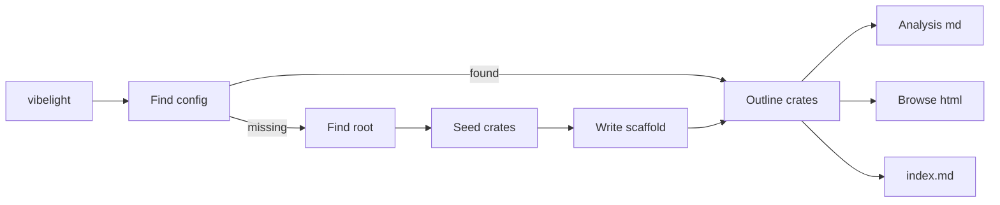

# Vibelight zero-switch redesign

The binary does the work, and the prompt ([vibelight/tools/vibelight.md](vibelight/tools/vibelight.md)) just runs it. Markdown is for models, so it always carries every analysis feature. HTML is for humans, so it always browses. Outlines are never committed.

This replaces the earlier per-format config keys plan.

## Evidence

- **Switch audit:**
  - `--facts`, `--order`, `--kill-list`, `--members`, and `--profile` have one real user, the agent tool, which always passes the same values. `--profile analysis` contributes nothing, because the tool overrides all four of its effects.
  - The three source-link switches, `--md-out`/`--html-out`, `enabled`, `--check`, `--check-html`, and stale detection exist only to keep committed outlines stable.
  - Crate selection is the only group that is earned.
- **Earlier analysis chats:**
  - Facts, `Fields:`, Same shapes, External items, visibility lines, attributes, Spellings, and MACRO marks each produced cited findings.
  - Every notation complaint was about decoding C++.
  - The C++ look was designed for a human C++ reader.

## Phase 1: zero-switch run, scaffold, fixed formats

**Command line** ([vibelight/src/main.rs](vibelight/src/main.rs), [vibelight/src/settings.rs](vibelight/src/settings.rs))
- `vibelight [<crate paths>...] [-o <dir>]`, plus `--help` and `--version`. Everything else goes.
- Crate paths replace only the config's crate choice. Its `follow` and `exclude` still apply, which is a change from today now that the flags are gone.
- `-o` replaces the config's `out`. Markdown goes in `<out>` and HTML in `<out>/html`.
- The `Flags`, `Plan`, and precedence code collapses. The `Switch` enum and the `struct_excessive_bools` expect go away.

**Config** ([vibelight/src/config.rs](vibelight/src/config.rs))
- Keys: `workspace`, `crates`, `follow`, `exclude`, `out` (default `.vibelight`).
- Removed keys become unknown-key errors, which is acceptable at 0.x. The version bump is the owner's call.

**Scaffold (new module, for example `src/scaffold.rs`)**
- **When it runs:** there are no crate paths and no `vibelight.toml` in the current directory or above.
- **Finding the root:** the nearest folder, at or above the current one, whose `Cargo.toml` has a `[workspace]` table. Failing that, the current folder if it holds a `Cargo.toml`. Failing that, the existing usage error.
- **Seeding the crates:**
  - `workspace = true` when the root has a `[workspace]` table, otherwise `crates = ["."]`.
  - `follow = ["**"]`, so the path dependencies that serve as context get outlined.
  - `exclude` holds the development crates, each with a `# reason` comment. These rules move here from the prompt's Resolve section:
    - `xtask` and `build-*` names
    - a crate run by an alias in `.cargo/config.toml`
    - a crate used only as a build dependency or a dev dependency of other members
    - fuzz, bench, and example crates, and test fixtures, judged by name or folder
- **Files written:** `vibelight.toml` at the root, `.vibelight/`, `.vibelight/html/`, and `.vibelight/.gitignore` holding `*.md` and `*.html`. Each gets a `note: created ...` line on stderr.
- **Every later run:** when the folder comes from the config (not `-o`), the run writes `<out>/.gitignore` if it is missing.

**Fixed formats** ([vibelight/src/pipeline.rs](vibelight/src/pipeline.rs), [vibelight/src/document.rs](vibelight/src/document.rs), [vibelight/src/legend.rs](vibelight/src/legend.rs), [vibelight/src/render_html.rs](vibelight/src/render_html.rs))
- **Markdown:** facts on, module order, kill-list counts, members by impl, source links on, Legend on.
- **HTML:** level order, full kill list, no facts, members by name, source links on, no Legend.
- `Options` becomes two constants, one per format. The pipeline builds `blocks` and `order` per format, since `members` differs. The shared-document shortcut goes away, and the cross-crate anchors come from the HTML build.

**Index, check, stale**
- Write `<out>/index.md` listing each outline with its crate dir, whether it was `selected` or `followed`, and its size in KB. It is not an outline, so stale detection ignores it.
- Remove `--check`, `--check-html`, and their code in [vibelight/src/check.rs](vibelight/src/check.rs). Committed markdown would change on every code move now, so a check has nothing stable to compare.
- A run removes stale outlines, the files that start like an outline, from its own markdown and HTML folders, since those folders are vibelight's cache.

**Tests**
- The harness ([vibelight/tests/it/support.rs](vibelight/tests/it/support.rs)) copies each fixture and writes into `<copy>/out`, the way `links.rs` does, so relative source links are stable.
- Drop the `args.txt` switch fixtures' arguments and keep their sources as ordinary fixtures. Drop the precedence tests in `settings.rs`, `config.rs`, and `tests/it/config.rs`, and the profile test in `cli.rs`.
- Remove `tests/it/parity.rs`, because the two formats now differ by design. The arrangement tests become HTML-only and strip links.
- New tests:
  - Scaffold on a garden copy: exact toml text and folders, and that a second run leaves them unchanged.
  - Crate paths with the config's `follow` and `exclude`.
  - The index contents.
  - Stale removal that ignores non-outline files.
- Every `expected.md` and `expected.html` changes. Per [vibelight/AGENTS.md](vibelight/AGENTS.md), read each diff before accepting it.

**Docs and prompt**
- [vibelight/README.md](vibelight/README.md): rewrite Run, vibelight.toml, and Using it in a repository (now the scaffold), drop Checking the files, and describe markdown and HTML separately.
- [vibelight/tools/vibelight.md](vibelight/tools/vibelight.md):
  - Outline runs plain `vibelight` at the repo root and prints that command.
  - The analysts' scope comes from `.vibelight/index.md`: selected outlines are targets, followed ones are context.
  - A crate the request names that the index lacks gets `vibelight <crate dir>`.
  - Delete the long command, the flag reasons, Resolve's exclusion rules (now in the binary), and "Ignore the HTML". Doc Roots skips `.vibelight/`.
  - The binary qualifies by behavior: it is accepted if a plain run leaves `.vibelight/index.md`. Otherwise try the next candidate or rebuild.

## Phase 2: markdown as Rust

Every C++ form is produced in the shared layout or in the model (for example, `&'a mut T` becomes `T mut& 'a` while the source is read). So the markdown needs its own layout, not a renderer tweak. Estimate: 1,000 to 1,600 lines.

- **Model additions** with the C++ output unchanged, and every golden still green as the check:
  - type text as written
  - the receiver as written
  - visibility as written, including on tuple fields
  - whether each trait is derived or hand-written
  - each trait impl's generics, self type, and `unsafe`
  - the re-export rename
- **New Rust layout modules for markdown only.** C++ blocks are still built for order, ids, the naming graph, and External items. Each type is one fenced block:
  - the item with `#[derive(...)]` as written, `#[attr]`, `#[cfg(...)]`, and fields in declared order with their `pub` prefixes
  - one `impl X { ... }` per source impl under its `// impl in <file>` line
  - an `impl Trait for X {}` line for each hand-written trait impl
- **Elsewhere in the markdown:**
  - re-exports print as `pub use a::b as c;`
  - Other impls print as `impl Trait for &X {}`
  - a const value that does not fit prints as `= ...;`
- **Legend and rules:**
  - The markdown Legend keeps only vibelight's own markers: MACRO, sections, `Source:`, facts, levels, and the stamp. That is about 3 notation lines instead of 9.
  - [vibelight/AGENTS.md](vibelight/AGENTS.md) changes its rendering rule: when no written rule covers a case, markdown looks like Rust source with the bodies removed, and HTML looks like a C++ header.
- **Goldens:** regenerate and read every markdown golden. All HTML goldens must stay byte-identical to the end of Phase 1.

## Verification (each phase)

- In [vibelight](vibelight): `cargo fmt --check`, `cargo clippy --all-targets --locked`, `cargo test --locked`, then `cargo build --release`.
- Garden temp copy with `git init`:
  - Plain `vibelight` creates the scaffold.
  - `git status --porcelain` shows only `vibelight.toml` and `.vibelight/.gitignore`.
  - The markdown has `Fields:` and `// impl in` lines (Rust syntax in Phase 2).
  - The HTML has no Legend and has the full kill list.
- Final check: plain `vibelight` at the runvil root. This adds `vibelight.toml` and `.vibelight/` there, as intended. Review the seeded `exclude` list against the earlier hand-made one (`crates/build-*`, `crates/harness-internal/test-plugin`).
- Leave everything uncommitted for review.

## Outcome

Both phases ran, uncommitted. `cargo fmt --check`, `cargo clippy --all-targets --locked`, `cargo test --locked` (145 unit, 136 integration), the 1.85 floor check, `cargo package`, and the release build all pass.

- **Phase 1 checked against the old binary.** Before any golden changed, the new markdown of every fixture was byte-identical to the old binary's `--facts --order modules --kill-list counts --members impl` output, apart from the reworded `Source:` Legend line, and the new HTML matched the old default page less its Legend (118 files). The goldens were then made from the old binary with links off.
- **Phase 2 checkpoint.** With the dual `Text` and every model addition in place, all goldens still passed before the Rust layout existed. The HTML goldens never changed in Phase 2.
- **Goldens hold no links.** Instead of writing each fixture's output inside a copy, the tests strip source links before comparing, since a link depends on where the output goes. The `links` fixture checks the links, and a new test checks that stripping leaves none behind.
- **Named crates are never excluded.** A crate named on the command line is outlined even when the config excludes it, and the unmatched-glob note is left out for such runs; the config's `follow` and `exclude` still apply to followed crates. A single `.rs` file ignores the config's globs.
- **The folder holds the last run.** Stale outlines are removed in both formats, so a run that names one crate leaves only that crate; the prompt uses `-o` for one-off crates.
- **Small changes not in the plan.** `pub(in crate)`, `pub(in self)`, and `pub(in super)` print as rustfmt writes them, which the narrow rustfmt arrangement test caught. The `Counts:` line says `Default/From/Drop impl` for the C++ "special member". The `profile` fixture and the six `args.txt` files went to the cabinet trash, `exclude_cli.rs` merged into `exclude.rs`, and new HTML goldens pin the level order, the name order, and the full kill list.
- **Runvil.** The first plain run took 2.5 seconds, wrote 48 outlines in each format plus the index, and seeded the same seven exclusions as the hand-made list. `git status` there shows only `vibelight.toml` and `.vibelight/.gitignore`.
