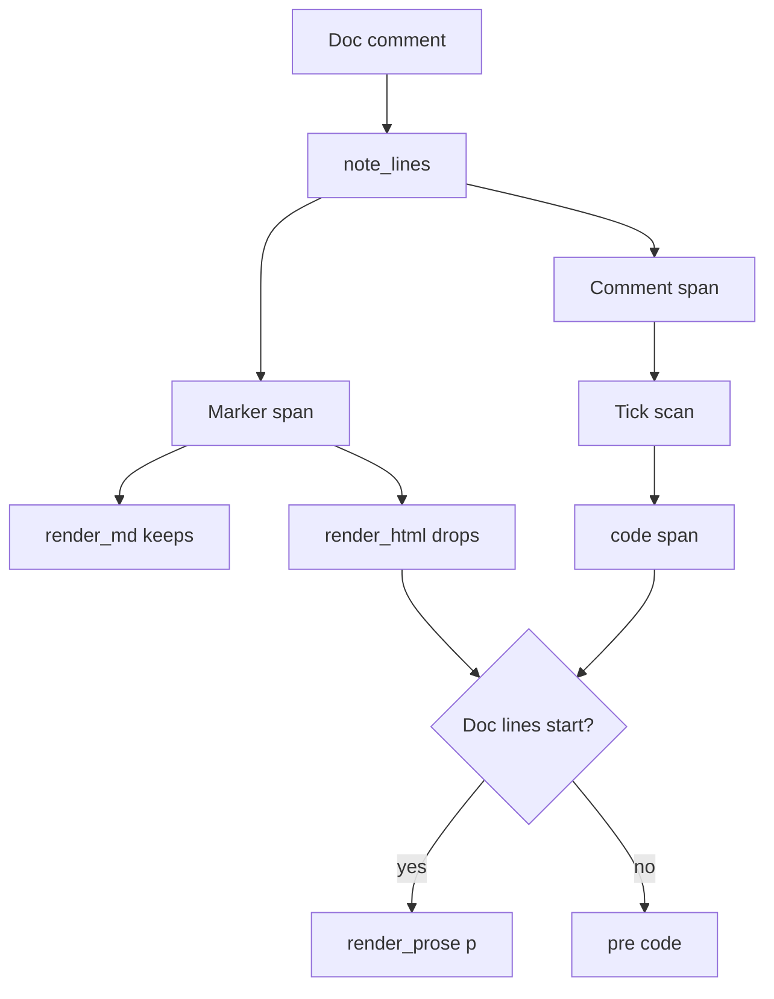

# Vibelight HTML: a reading revision

Note: items 6 and 7 and the legend count were revised by later commits, so the show/hide toggle, the comment box, the legend, and the index page differ from the wording below (the legend has more lines than the six to eight planned, each member comment reflows as one paragraph in a borderless box, and the index page lists the size of each markdown outline); `src/render_style.rs`, `src/render_html.rs`, and `src/index.rs` are the truth.

## What changes and what does not

Selected scope is reading only. In scope: strip comment markers, render type and module doc
comments as proportional reflowed prose, render backticked comment text in code font, put member
comments in toggleable boxes with a CSS-only show/hide button, a measure instead of full width, a
short HTML legend, and an `index.html` landing page. Out of scope: unique group captions, `Used by`
in HTML, impl-file boundaries inside a type, and fields before methods. The markdown outline does
not change, and no golden `.md` may change. The page keeps its no-JavaScript promise.

## The one structural idea

A comment marker is metadata about a comment, not comment text. Today it is glued into the text:
`note_lines` builds `Span::Comment("/// ")` and `mark_line` builds `Span::Comment("// ")`. Adding a
`Span::Marker(&'static str)` variant lets markdown print the marker and HTML drop it, with the
compiler finding every site. The same variant then gives the prose rule a precise predicate:
a block's leading lines whose first span is a doc marker are that declaration's doc comment.



## Work items

No order is required between items 1, 5, 6, and 7; item 2 needs item 1, item 3 needs item 1, item 4
needs items 2 and 3, and item 8 needs the rest.

### 1. Type the comment marker

Files: `src/layout.rs`, `src/wrap.rs`, `src/render_md.rs`.

- `Span` gains `Marker(&'static str)`: the exact text markdown prints, such as `"/// "`, `"///"`,
  `"//! "`, `"// "`, `"// cfg: "`, `"// impl in "`, `"// impl "`.
- `span_text` returns the marker, so markdown width and text stay byte-identical.
- `note_lines` in `src/layout.rs` pushes `Marker` then the text, instead of one fused `Comment`.
  The `starts_bare` branch chooses `"/// "` or `"///"`, and module docs choose `"//! "` or `"//!"`.
- `Note::Plain` in `note_lines` splits a leading `//` into `Marker("//")` plus the rest, so an
  ordinary comment loses its slashes in HTML too. A `/* */` comment keeps its text as written.
- `above` emits `Marker("// cfg: ")` for a cfg line; `mark_line` emits `Marker("// ")`.
- `src/render_md.rs` and `src/wrap.rs` gain the `Marker` arm wherever they match on `Span`; the
  compiler names each site.

Acceptance: every `expected.md` golden is byte-identical.

### 2. Render doc comments as prose

Files: `src/render_prose.rs` (new), `src/render_html.rs`.

New module `render_prose` holds the rules, so `render_html` stays under the 500-line ceiling.

- `render_prose::block(out, block, render_spans)` takes a `&Block` of comment lines and the
  inline renderer as a closure, and writes HTML.
- Segmentation of the doc text, after markers are dropped:
  - A fence opener (3+ backticks or `~~~`) starts a code segment that ends at its closing fence,
    written verbatim in `<pre><code>`. This is the case that must not go proportional.
  - A blank line ends the current paragraph.
  - A line starting with `- ` or `* ` opens or continues a `<ul>`; its indented continuation
    lines join that bullet, and a new bullet starts a new `<li>`.
  - A line starting with `# ` (for example `# Errors`) becomes `<h4>` with the rest as its text.
  - Any other line joins the current paragraph with a single space.
- `render_html::pre` becomes: take the leading run of lines whose first span is a doc marker,
  hand it to `render_prose::block`, then write the rest in `<pre><code>`. The same call replaces
  the direct `page.pre(&mut out, docs)` at the top of the page for crate docs, so crate docs,
  module docs, and type docs all read as prose.
- A line that carried a dropped marker loses one leading space before it is written, so a member
  comment still sits correctly under its indent.
- `src/render_html.rs` keeps its existing `<pre>` path for everything else, including member and
  field comments, which stay aligned with the code they annotate.

Acceptance: `cargo nextest run` passes with the regenerated goldens; a unit test in
`render_prose` pins each of the five cases.

### 3. Render backticked comment text in code font

Files: `src/render_html.rs`, `src/render_style.rs`, `src/render_prose.rs` (new).

This applies to every comment in the page, prose blocks and `<pre>` blocks alike, so it lands in
the shared span path rather than in `render_prose`.

The scan is per rendered line, not per span. A code span can wrap a resolved type link, and that
link is its own span: in `runvil_lua.html` 148 of 1632 backticks wrap an `<a>`, and one line holds
a two-tick span around a one-tick span. So one `Span::Comment` carries the opening run of two
ticks, a `Ref` span carries the inner name, and the next `Span::Comment` carries the closing run.
A span-at-a-time scan cannot find that pair.

- `render_html::spans` becomes line-aware: it collects the line's spans, concatenates their escaped
  text with the markers dropped, finds backtick runs in that text, and emits `<code>` around each
  matched pair. The nesting is a counter holding the open run's length: a run of `n` ticks opens a
  code span only when none is open, and closes it only when `n` equals the open run's length.
  This is the longest-run rule `render_md::code_span` already applies, so both formats agree on
  which run pairs with which.
- A backtick that never finds its match stays literal text, so a stray tick in a doc comment
  cannot swallow the rest of the page.
- Inside a `<pre>`, `<code>` must not change the size of comment text that is already monospace,
  so give it `.c code{font:inherit}`. In prose, `.doc code` gets the monospace font, a subtle
  background, and small padding from item 4.
- The markdown path is untouched: `render_md` already emits its own balanced code spans through
  `code_span`, and its goldens must stay byte-identical.

Acceptance: a unit test pins an inline pair, a pair wrapping a link, a run of two ticks around a
run of one, an unmatched tick left literal, and a backticked name in a member comment inside a
`<pre>`. The `doc-forms` fixture gains one doc comment with each of those shapes.

### 4. Bound the measure and style the prose

File: `src/render_style.rs`.

- Add `.doc p,.doc ul,.doc h4{max-width:46rem}` and `.doc pre{max-width:64rem}`.
- Give `.doc p` and `.doc li` the body font and add `margin:.5rem 0` spacing, and `.doc ul` a
  small left padding with disc bullets.
- The two `code` rules from item 3 land here.
- Do not change `main{flex:1}`, so code blocks keep the full width they need.
- Extend the existing style test with the new selectors.

### 5. A short legend for the HTML notation

Files: `src/legend.rs`, `src/settings.rs`, `src/document.rs`.

- `src/legend.rs` gains `html_items()`, six to eight one-line bullets: `[[attr]]` is an API-shaping
  attribute, `() mut` takes `&mut self`, `static` has no receiver, `: Trait` is a base-list trait,
  `class` is all-private and `struct` has a public member, `internal:` and `private:` are the
  non-public sections, `implements:` is an impl with no type to attach to, and a `MACRO` line names
  a macro.
- `settings::HTML` becomes `legend: true`.
- `document::build` picks `legend::html_items()` under `Notation::Cpp` and `legend::items()`
  otherwise, so the markdown Legend keeps its `Counts:` and `Used by:` description.

### 6. Collapsible member comments

Files: `src/render_html.rs`, `src/render_style.rs`, `src/render_prose.rs` (new).

Goal: a reader scanning a large type can hide every member comment at once and see the members
alone, and a shown comment reads as a faint callout rather than as another line of code.

No JavaScript. A hidden checkbox at the top of `<body>` drives it, and its label, in the sticky
sidebar, is the button:

```html
<body>
<input type="checkbox" id="hide-members" class="toggle">
<nav>... <label for="hide-members" class="button"><span class="on">Show comments</span><span class="off">Hide comments</span></label> ...</nav>
<main>...
```

The default is unchecked, so comments are shown when the page opens, and the label reads
"Hide comments".

- `render_html::render` writes the checkbox as the first element after `<body>`, and `render_style`
  hides it with `position:absolute;opacity:0;width:1px;height:1px` rather than `display:none`, so it
  keeps its place in the tab order and toggles with the space bar.
- The label is a `<label for>` styled as a button, with `#hide-members:focus-visible+nav .button`
  giving it a focus ring. Its two spans swap on state:
  `#hide-members:checked~nav .off{display:none}` and, by default, `.on{display:none}` with
  `#hide-members:checked~nav .on{display:inline}`.
- The hiding rule is `#hide-members:checked~main .mc{display:none}`.

**Which lines become boxes.** Inside a `<pre>` only, a run of consecutive comment-only lines whose
indent is at least 4 becomes one box, so one member's comment block is one rectangle rather than
one per line. That indent test is what keeps `// internal`, `// cfg:`, and `// impl Trait` visible,
since those sit at indent 0 and state the type's own contract, and it keeps `[[attr]]` lines
visible, since those are attribute spans and not comments at all. The leading doc run never becomes
a box, because item 2 already renders it as prose.

**The newline is the trap.** A `<span class="mc">` cannot simply wrap the text, because the newline
after it belongs to the text node outside the span, so hiding the span would leave an empty line
per hidden comment. So the pre writer stops emitting a blanket newline between lines: it emits the
newline after a line only when the next output starts inline, and writes no newline after a box,
which as `display:block` begins and ends its own line. Consecutive comment lines in one run are
joined inside the box by literal `\n`, and the box carries no trailing newline of its own.

A unit test pins three cases: a box between two code lines leaves no blank line when hidden and no
blank line above or below when shown, a box that ends a block leaves no trailing blank line, and a
comment run interrupted by a code line becomes two boxes rather than one.

**The box.** `render_style` gains `.mc{display:block;white-space:pre;background:var(--side);
border:1px solid var(--rule);border-radius:5px;padding:.25rem .5rem;margin:.4rem 0}`. The border
carries the faint contrast against the `pre` background, the 5px radius is the mild rounding, and
`white-space:pre` keeps the comment's own indentation and any alignment inside it.

**What it does not hide.** A trailing comment on a code line (`field: u8, // note`) stays, because
it shares a line with code and cannot be removed without changing the line. Record that as a known
limit in the README rather than trying to solve it.

### 7. An index.html landing page

Files: `src/index.rs`, `src/pipeline.rs`.

- `index::Entry` gains `html_bytes: usize`, set in `pipeline::outline` from the rendered page.
- `index::render_html(entries, stamp) -> String` writes a complete page in the same shape as an
  outline: the stamp comment, `<!DOCTYPE html>`, the inline style sheet, and a `<h1>`. It lists one
  `<li>` per crate with a link to `<stem>.html`, the crate folder in a `<code>`, whether the crate
  was selected or followed, and the page size. The stamp is the run's one stamp, so every page
  agrees.
- `pipeline::outline` pushes `html.dir.join("index.html")` after the markdown index.
- `src/index.rs` gets a unit test for the page's title, one link per entry, and the stamp line.

### 8. Goldens and documentation

Files: `tests/fixtures/*/expected.html` (about 30), `README.md`.

- Regenerate every `expected.html` with the binary and read each diff before committing it. Per
  `AGENTS.md` the goldens are the specification, so a diff that is not the intended reading change
  is a defect in this work, not a golden to bless.
- Do not touch any `expected.md`; a change there means the markdown path broke.
- Update the README's "The HTML notation" section: markers dropped, doc comments as prose,
  backticked text in code font, the legend, the comment toggle and its trailing-comment limit, and
  `html/index.html` in "The folder".
- Update the `vibelight` tool description in `Cargo.toml` and the first README paragraph only if
  the wording there now misdescribes the page; they say "in the style of a C++ header", which
  stays true.

## Verification

Run from `c:\Users\Vinnie\cursor\vibelight`:

- `cargo nextest run` (or `cargo test`), which also runs the build script's structure check: the
  500-line ceiling, the module-doc rule, the module naming rule, and the plan-name rule.
- `cargo clippy --all-targets`, which denies `all` and warns on `pedantic`.
- `cargo fmt --check`.
- `cargo run -- . -o target/outline-check` on this crate, then open
  `target/outline-check/html/vibelight.html` and `target/outline-check/html/index.html` and confirm
  by eye that a doc comment reads as prose, a backticked name inside a sentence is visually
  distinct from the words around it, a fenced example stays monospace, and the page is narrower
  than the window.
- In that page, click the hide-comments button and confirm three things: no blank gap is left where
  a member comment was, the members that remain line up as they would in source, and clicking again
  restores every comment. Then confirm the button toggles from the keyboard with the space bar and
  shows a focus ring.
- Copy the plan to `plans/2026-10-29-html-reading-revision.plan.md`, per `AGENTS.md`.

## Risks

- The prose split is a rendering heuristic, so a block whose doc comment is followed by nothing at
  all must still emit its prose and an empty `<pre>` must not appear. A unit test pins it.
- Fenced code inside a doc comment is the one case where proportional text would be wrong; the
  fence rule is the guard, and the `doc-forms` fixture already holds a fenced doc.
- Turning the legend on adds about eight lines to every page, so the goldens move even for fixtures
  that have no doc comments.
- The backtick scan runs over escaped text, so a comment that writes a literal `&lt;`-like sequence
  must not confuse the run finder. Escape after matching, not before: match on the raw span text
  and escape each emitted piece.
- The comment toggle is CSS-only, so it cannot remember a choice between pages or between visits.
  That is the cost of keeping the no-JavaScript promise, and it is the reason the default is shown.
- Replacing the per-line newline in the pre writer is the riskiest change in this plan, because a
  wrong count shows up as a subtle gap rather than as a wrong word. It is worth its own commit and
  its three unit tests before any golden is regenerated.
