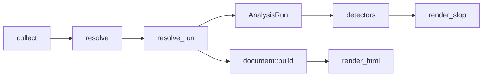

# Vibelight markdown rewrite: a lead-first slop outline

## Constraints

- **Separate analysis path, byte-identical crate HTML.** New analysis modules build an immutable `AnalysisRun` before `attach::attach`; new renderer modules consume only that snapshot. The existing attach and HTML build sequence remains semantically unchanged. Shared files lose markdown-only branches, so the honest contract is byte-identical crate HTML, not unchanged executed lines. Phase 1 pins 58 fixture target HTML files after source-link normalization and pins `links/expected.html` raw, including source URLs; temporary-package tests retain their focused assertions. `html/index.html` is the one explicit exception because it reports each newly sized markdown file ([vibelight/src/index.rs](vibelight/src/index.rs) lines 47-51).
- **Repository structure rules** ([vibelight/build/structure.rs](vibelight/build/structure.rs), enforced by `build.rs` and `tests/it/structure.rs`):
  - every non-fixture `.rs` file under `src/`, `tests/`, or `build/` has at most 500 lines (`LONG_FILE`); `tests/fixtures/` is exempt;
  - every `.rs` file under `src/` starts with `//!` on line 1 (`MODULE_DOC`);
  - no `mod.rs` in non-fixture checkout code (`MOD_RS`) - fixtures are exempt; use flat sibling files (`analysis.rs`, `analysis_body.rs`, `analysis_manifest.rs`, `census.rs`, `render_slop.rs`, `render_slop_decl.rs`, `leads.rs`, `leads_shapes.rs`, `leads_names.rs`, `leads_docs.rs`, `leads_census.rs`, `leads_body.rs`, `leads_containers.rs`, `leads_comments.rs`);
  - no `src/lib.rs`, no extra `Cargo.toml`, no `#![allow/deny/warn/...]` in `src/*.rs`;
  - plan copy in `plans/` must be `vibelight/plans/2026-10-29-markdown-slop-renderer.plan.md` (1-3 kebab words).
- **Zero switches, syn only, MSRV 1.85.** Edition 2024, `rust-version = "1.85"`; do not use let-chains (they require 1.88).
- **No body code text.** Body facts (counts, observed call edges, direct operation names, sorted token-shingle hashes, adjacent-statement fingerprints) and normalized source-faithful comments are in. Executable tokens never print.
- **Leads, not verdicts.** Each lead id is descriptive kebab-case, such as `same-type-params`.
- **Never present absence as compiler knowledge.** Negative census leads are named `no-observed-*`, state their blind spots (macros, dynamic dispatch, external consumers), and cover only `pub` items, test-only observations, and items kept alive by `allow` or `expect(dead_code)`. The verifier, not the detector, decides whether deletion is sound.
- **Context-dependent markdown.** Leads use all targets and packages present in the run. Adding or excluding a crate may change another crate's markdown and stamp. Crate HTML remains target-local and unchanged. Tests that previously required retained markdown to stay identical across different run membership are updated to require that only of HTML.
- **Every phase is warning-clean under `-D warnings`.** Before the renderer consumes analysis data, meaningful invariant validators are invoked by the production pipeline: collected body facts validate unique ids and sorted fingerprints, `AnalysisRun::validate` reads every snapshot field, and `validate_leads` reads every lead field. No dead fields, dummy `black_box`, or lint suppression is allowed. The renderer replaces these temporary terminal consumers in phase 5; invariant validation remains under debug assertions and tests.
- **Goldens are the spec** ([vibelight/AGENTS.md](vibelight/AGENTS.md)). Because phases 2-4 build the facts, census, and detectors behind model-level unit tests without touching the markdown renderer, all 59 markdown golden files change **once** in phase 5 (52 regular target outputs, `links/expected.md`, and six workspace outputs), and each is read in full.

## Architecture



After `resolve_run::link`, `analysis::build` reads all still-unattached crates and creates one immutable `AnalysisRun`. It logically associates impls without draining them, owns stable body and item ids, builds package/target relationships, and computes the census. The detector registry then produces a sorted `Vec<Lead>` per target from that snapshot. The existing loop calls `attach::attach` and builds HTML as before. At render time, pipeline creates `RenderInput { analysis_target, leads, stamp, target_kind, shown_dir, link_base }`, where `TargetKind` is `Lib`, `Bin`, or `SingleFile`. Environment-dependent paths and stamps never live in `AnalysisRun`. The markdown renderer never reads the mutated crate or goes through `document::build`.

## Shared code

The old markdown generator is woven into files the HTML also uses. vibelight builds with `-D warnings` ([vibelight/.cargo/config.toml](vibelight/.cargo/config.toml) line 6), so it cannot be left in place unused, and keeping it alive with `#[allow(dead_code)]` is the slop the tool flags. Three rules govern every edit outside the new files.

**Rule 1. Shared rendering files: delete markdown-only behavior and its no-op HTML calls (in Phase 5).** If deleting a variant would leave an enum with one variant, keep that enum and its HTML arms exactly as they are; collapsing it would rewrite HTML lines and is out of scope.
- [vibelight/src/settings.rs](vibelight/src/settings.rs):
  - delete `MARKDOWN` (lines 63-70) and the unit test assertion `assert_eq!(plan.markdown().options, MARKDOWN);` (line 212);
  - delete the variants only `MARKDOWN` constructs: `Notation::Rust`, `KillList::Counts`, `OrderBy::Modules`, `MembersBy::Impl`;
  - delete the `facts` field on `Options` and `facts: false` in `HTML`.
  - replace `Plan::markdown()` with `Plan::markdown_dir(&self) -> &Path`; `Output` and `Options` then describe HTML only.
- [vibelight/src/document.rs](vibelight/src/document.rs): delete `facts` on `Builder` (lines 130, 178), `b.external(docs)` and `b.shapes()` (lines 212-213), the `OrderBy::Modules` arm (lines 195-198), the `KillList::Counts` arm (line 217), and the `Notation::Rust` legend arm (line 222). Remove `docs` from `document::Inputs`.
- [vibelight/src/document_sections.rs](vibelight/src/document_sections.rs): delete the no-op HTML call `self.facts(d)` at line 122. All other HTML section code stays.
- [vibelight/src/layout_items.rs](vibelight/src/layout_items.rs): delete the `Notation::Rust` arms (lines 24-27, 77-89, 318-335, 392-413) and the import at line 11.
- [vibelight/src/layout_decl.rs](vibelight/src/layout_decl.rs): delete the `MembersBy::Impl` arm (lines 57-60) and `impl_groups` (line 251).
- [vibelight/src/document_modules.rs](vibelight/src/document_modules.rs): delete `module_sections` (line 25). `sorted_modules` stays.
- [vibelight/src/legend.rs](vibelight/src/legend.rs): delete `items` and `LINES` (lines 8-20, 47-55). `inlines` and `html_items` stay.
- Delete all of [vibelight/src/document_external.rs](vibelight/src/document_external.rs). Its `external()` and declaration-only flattened `first_docs()` are markdown-only. `AnalysisRun` builds a normalized raw-doc summary index for both declarations and module values.
- Whole markdown-only files deleted in Phase 5: `render_md.rs`, `layout_rust.rs`, `layout_rust_decl.rs`, `layout_rust_items.rs`, `document_facts.rs`, `document_shapes.rs`, and `document_external.rs`. Logic worth keeping (inline Rust signatures, counts, field index, variant text, same-shape grouping, external item summaries) moves into new analysis or renderer files. The old `layout_rust::fn_lines` is explicitly not reused because it wraps parameter comments and where clauses.

**Rule 2. Orchestration files: markdown additions and deletions only.** The lines that build, render, write, and clean up HTML stay as they are.
- [vibelight/src/pipeline.rs](vibelight/src/pipeline.rs):
  - after `resolve_run::link` (line 70), build `AnalysisRun` from immutable, unattached crates and package/target metadata; compute analysis surfaces, spelling records, and raw-doc summaries inside that snapshot;
  - leave the existing per-crate `attach::attach`, surface/spelling calculation for HTML, and `Parts::build(&html)` behavior semantically unchanged;
  - call `render_slop::render(RenderInput { ... })` on the target's immutable analysis snapshot in place of `render_md::render` (line 104); create the markdown `LinkBase`, shown directory, stamp, and exact target kind there;
  - delete the markdown `parts.build` call (line 91) and the `Notation::Rust` arm in `Parts::build` (lines 162-170);
  - remove `docs` from HTML `Parts` after the `document::Inputs.docs` deletion;
  - keep `bytes: text.len()`, now measured on the new markdown.
- [vibelight/src/main.rs](vibelight/src/main.rs): `mod` declarations change, and the spelling warning says “see spelling records” instead of naming the removed Spellings section.
- [vibelight/src/folders.rs](vibelight/src/folders.rs): update `plan.markdown().dir` at line 39 to `plan.markdown_dir()`. `is_outline` (lines 101-122) accepts the new JSON header on line 2. The old markdown check stays for one release so stale old-format files are still cleaned up, and the HTML check stays as it is.

**Rule 3. Collection and resolution files: analysis additions do not alter HTML-visible values.**
- `collect_body.rs`, `collect_fn.rs`, `collect_impl.rs`, `collect_type.rs`, `collect_use.rs`, `model.rs`, `model_impl.rs`, `manifest.rs`, `inputs.rs`, `root.rs`, `modtree.rs`, and resolver files may add analysis-only fields and records.
- Add stable `ItemId` and `BodyId`. `BodyId` is `(target_id, file_id, byte_start, body_kind, owner_ordinal)`, never the line-only `Loc`; `ItemId` identifies associated types and other declaration-only items. Nested closures and async blocks aggregate into their enclosing body while retaining nested-depth facts. Store `BodyFacts` and analysis-only signatures for free functions, inherent methods, trait-impl methods, trait default methods, consts including anonymous `const _`, statics, associated consts/types, and enum discriminants. Existing `Impl.members` remains inherent-only for HTML; trait-impl analysis members live separately.
- Add `ManifestFacts` beside existing path-dependency data. Existing `Package.deps` and `crate_map` behavior for HTML stay unchanged. `ManifestFacts` records features, `publish_allowed`, every dependency kind and target table, explicit/default test, bench, example, build-script paths, and package/target identity. Add same-package binary-to-library relationships to `AnalysisRun`, not to HTML's crate map.
- Add `TargetKind::{Lib, Bin, SingleFile}` to `root::Target` and set it at target discovery; keep the existing `lib` field and all HTML decisions unchanged.
- Swapping `discard` for `take` leaves the comment pool in the same state, and the taken comments go only into new fields.
- The scan of test code reads files into a separate identifier index and never adds them to the module tree.

**Untouched:** `render_html.rs`, `render_spans.rs`, `render_prose.rs`, `render_values.rs`, `render_style.rs`, `groups.rs`, `document_values.rs`, `document_kill.rs`, `document_spellings.rs`, `document_surface.rs`, `spellings.rs`, `surface.rs`, `order.rs`, `order_graph.rs`, `test_support.rs`, `index.rs`, and `stamp.rs`. The new renderer reuses `stamp::markdown`.

## Output format

The file is compact JSON Lines after the existing stamp. Line 1 remains `*Updated <stamp>*` so stamp masking stays unchanged. Every later line is one compact JSON object, with no blank lines, indentation, or wrapping. JSON escaping preserves exact signatures and normalized comments, including pipes, quotes, backslashes, and embedded newlines.

```text
*Updated <stamp>*
{"k":"vibelight-outline","schema":1,"crate":"runvil_parser","target":"lib","dir":"crates/runvil-internal/parser"}
{"k":"modules","items":[{"path":"contract","from":18,"to":29},{"path":"contract::args","from":30,"to":44},{"path":"fence","from":45,"to":68}]}
{"k":"lead","id":"generic-twin","mode":"direct-syntax","subjects":["contract::args::ArgsDecl","contract::models::ModelRoles"],"evidence":"BTreeMap<String,_>; get iter len is_empty; IntoIterator for &; Deserialize","locs":["src/contract/args.rs:162","src/contract/models.rs:93"]}
{"k":"mod","path":"contract::args","loc":"src/contract/args.rs:1","vis":"public","types":5,"functions":{"private":2}}
{"k":"doc","path":"contract::args","text":"Parses the `args` frontmatter key into typed arg declarations.\n\nThe declaration advertises, ..."}
{"k":"struct","path":"contract::args::ArgDecl","rust":"pub struct ArgDecl { kind: ArgType, optional: bool, default: Option<serde_yaml_ng::Value>, description: Option<String> }","loc":"src/contract/args.rs:51","attrs":["non_exhaustive"],"derives":["Clone","Debug","Eq","PartialEq"],"named_by":["ArgsDecl","ArgsDeclIter"],"reexported_by":["contract","crate"]}
{"k":"doc","path":"contract::args::ArgDecl","text":"The declaration of one prompt arg: its type, whether it is optional, its default, and its description."}
{"k":"fn","path":"contract::args::ArgDecl::is_optional","sig":"pub fn is_optional(&self) -> bool","loc":"src/contract/args.rs:89","attrs":["must_use"],"body":{"statements":1,"tokens":6,"single":"field optional"},"ops":["self.optional"]}
{"k":"doc","path":"contract::args::ArgDecl::is_optional","text":"Returns whether a call may omit this arg entirely.\n\nAn omitted arg is absent from the call. An empty string is a supplied value."}
```

Exact schema, source-link, and determinism rules:
- **Schema and kinds.** The header has integer `schema:1`. `k` is one of `vibelight-outline`, `modules`, `lead`, `doc`, `mod`, `struct`, `enum`, `union`, `trait`, `alias`, `field`, `variant`, `fn`, `const`, `static`, `extern`, `use`, `impl`, `macro`, `unsupported`, `surface`, `external`, `spelling`, or `wire-keys`. `doc` is always legal, even if the long-line fallback is not needed.
- **Header `dir`.** Uses `shown(&chosen.base, &chosen.packages[p].dir)`; omit `dir` when it is `.` so temp directories never enter output.
- **Header `target`.** Serialize `TargetKind::Lib` as `"lib"`, `Bin` as `"bin"`, and `SingleFile` as `"single-file"`; never infer single-file from `Target.lib == false`.
- **Module ranges.** The `modules.items` array is sorted by module path. `from` and `to` are 1-based inclusive output-line ranges covering that module's contiguous catalog records, including adjacent `doc` records. Empty modules omit the range.
- **Locations.** Every source location uses `krate.files[loc.file].rel` with forward slashes. A location is one string, `<file>:<line>`, or `<stem>:<file>:<line>`, and no record has a `url`. Lead and impl records use a `locs` array.
- **Golden normalization.** `strip_markdown_links` preserves the stamp line, parses each JSON object, drops the header's `root`, replaces structural source `line` and body-comment line numbers with sentinel `0`, and serializes keys in renderer order. It never searches arbitrary doc/comment text for `#L`. This preserves existing formatting/attribute invariance without brittle text matching.
- **Shapes and signatures.** A type's complete Rust shape is the one-line `rust` string. Every free, inherent, trait-impl, and trait-default signature is the one-line `sig` string; where clauses stay inline. Parameter docs live in `param_docs`.
- **Attributes.** Arrays are sorted using existing `name_order`; `test_support:true` marks test-support records.
- **Docs and comments.** Strings are normalized source-faithful text. Paragraph and source line breaks are retained as JSON `\n`; fenced examples stay exact after LF normalization. Body comments are objects with normalized `text` and source `line`.
- **Order.** Stamp, outline header, modules, lead records grouped by id and sorted by subject path, then `surface`, `external`, `spelling`, `wire-keys`, then catalog records by module path and source line.
- **Summary leads.** More than 5 instances of one id in one module become one lead object with `module`, `count`, and `subjects` sorted by `name_order`.
- **Evidence modes.** Every lead has `mode:"resolved"`, `"direct-syntax"`, or `"lexical"`. Absence leads also include a compact `limits` array, such as `["macros","dynamic-dispatch","external-consumers"]`.
- **Cross-crate leads.** Print in every involved target's file, with subjects sorted by package, target, and item path.
- **Canonical schema.** Define a typed `Record` enum tagged by `k`, with one `#[serde(deny_unknown_fields)]` struct per kind. Required fields are non-`Option`; optional fields are `Option` and omitted when empty; arrays and nested objects have typed element structs. This enum, rather than prose key lists, is the canonical required/optional key and value-type matrix. Record variants serialize in the listed output order, and each variant sorts its arrays before construction.
- **Schema validation.** Add direct `serde` derive and `serde_json` dependencies, pinned by `Cargo.lock` to releases that pass Rust 1.85. Tests parse every line into the typed `Record`, reject unknown/missing keys, CR characters, blank lines, wrong record order, duplicate subjects, unsorted arrays, and invalid module ranges. Validation has two explicit modes: `Raw` requires positive source lines and `NormalizedGolden` requires the line sentinel 0. A location is one string, `<file>:<line>`, or `<stem>:<file>:<line>`, and no record has a `url`.
- **Long-line fallback.** Phase 5 tests `Read` and `Grep` on a 5,000-character line. If either truncates, docs always become a separate `{"k":"doc","path":...,"text":...}` record immediately after the owner. The `doc` kind is already in the schema, so this decision does not alter the grammar. A record wider than 900 characters continues in `more` records, which follow it and carry the rest of one array or one string.

## Comments

- Keep two analysis-only forms where needed:
  - normalized raw doc text, before `flatten` removes reference definitions and rewrites intra-doc links;
  - the existing flattened `Note::Doc`, still used by HTML and useful for resolved-name facts.
- Ordinary comments are normalized source-faithfully: CRLF becomes LF and block-comment continuation indentation follows the existing rustfmt-stable normalization in `comments.rs:257-276`. JSON escaping is lossless after that normalization.
- Collect comments from every non-test-only body already in the production/test-support catalog, plus const/static and associated-const initializers, enum discriminants, and macro-containing expressions. Pure cfg(test) and separate test targets contribute use-census facts only. Body and expression comments keep source line numbers in real output:
  - In [vibelight/src/collect_fn.rs](vibelight/src/collect_fn.rs) line 28, and in [vibelight/src/collect_impl.rs](vibelight/src/collect_impl.rs) lines 192 and 346, replace `discard` with `pools[..].take(range)`.
  - Add a take for each trait-impl method, before the whole-scope discard at `collect_impl.rs:94`.
  - Replace discards in `collect_use.rs:200` and `collect_type.rs:141` with analysis-only comment collection while leaving the comment pool state unchanged.
  - The take must happen before `node_notes`, so body comments never become item notes.
- Narrating comments are flagged by a lead, never hidden.

## Lead ids by detector group (each line: id: rule)

### Group A: signatures, shapes, names, attributes (`leads_shapes.rs`, `leads_names.rs`)

- option-as-flag: `Option<()>` or `Option<bool>`
- contained-shape: a type with at least 3 fields has every field, with the same name and type, inside another type; named enum payloads count as shapes
- derived-field: a `span`/`range` field sits beside position fields (`line`, `column`, `offset`), or a collection field sits beside a same-stem `_len`, `_count`, or `is_*` field
- drop-option: an Option field on a type with a Drop impl
- fallible-accessor: an Option/Result method whose only `self` field is an Option
- direct-field-clusters: the graph of direct `self.field` accesses, with hubs removed, has 2 or more groups, and it needs 4 or more methods that reach the fields; this is not alias-aware
- option-shaped-enum: one unit variant plus one single-value variant
- same-shape: the existing rule
- generic-twin: two types are alpha-equivalent after replacing exactly one differing canonical leaf type in fields and matching method signatures
- mirror-enum: same variant names, compared across the run
- field-and-accessor: a non-private field that also has an accessor
- redundant-constructor: 2 or more constructors with the same parameter types, or `new()` beside `Default`
- inverse-pair: X to Y and Y to X in one module, or `From` both ways
- spelling-table: a serde-renamed enum plus `Display`, or a `fn(E) -> &'static str`
- compat-shim: `deprecated`, or a whole identifier word `legacy`, `compat`, `old`, `v2`, or `shim`
- lint-suppression: an `allow` or `expect` lint attribute
- test-knob: a production declaration or field name contains a whole identifier word `test`, `mock`, `fake`, `fixture`, or `override`
- same-signature: the same nontrivial parameter, generic, where-clause, and return shape occurs under different names in different modules; conventional zero/one-argument accessors are excluded
- cross-crate-duplicate: two targets have the same uncommon item name and the same signature or type shape
- prelude-name: a crate item named like a std or prelude item
- name-collision: one name for a module and a fn, or for several kinds of item
- same-name-many-types: the same case/underscore-normalized field or parameter name has at least 2 distinct canonical types in one module or type
- same-type-many-role-names: the same canonical type appears under at least 3 distinct field/parameter names in one module or type and those names share a nontrivial normalized stem; primitive types require that shared stem
- synonym-mix: one declared role uses several words from the versioned sets name/title/label, body/content/text/source, kind/type/class, and id/key/index
- wrapper-name-family: `_inner`, `_impl`, `_body`, `do_`, `_helper` siblings
- getter-style-mix: `get_x` and `x` styles mixed in one crate
- impl-spread: inherent impls across 3 or more files
- direct-impl-field-split: one impl file's methods directly access only fields another file's methods directly access
- single-item-module: a module holds one non-reexport item, or only impls; module-boundary intent is left to verification
- pub-off-surface: `pub`, but not on the public surface
- hidden-non-exhaustive: `non_exhaustive` on a type absent from every `surface` record in the run; `publish_allowed` is context, never proof of publication
- param-clump: the same 2 or 3 parameters (type plus name) in 3 or more fns
- tuple-return: a tuple return with 3 or more parts, or 2 parts of the same type
- out-param-cursor: a `&mut` primitive parameter
- same-type-params: 3 or more parameters of one primitive type
- underscore-param: a `_name` parameter outside a trait impl
- error-family: error types per crate, with their overlapping variants
- stringly-typed: a String field or parameter named kind, type, mode, status, role, or state
- uniform-payload: every variant carries the same payload
- single-variant-enum: an enum has one variant
- one-observed-trait-impl: only one direct trait impl is observed in the run; macro and external impls are blind spots
- thin-wrapper-one-observed-user: a one-field struct with no methods and one observed user
- manual-serde: a hand-written Deserialize beside a wire twin, or for a tiny enum
- module-cycle: modules that import each other

### Group B: doc text (`leads_docs.rs`)

- conditional-field: an Option, Vec, map, or bool field whose doc has a condition (when, only, unless, empty for)
- partial-doc-list: a doc lists some of an enum's variants, but not all
- history-words: a doc that says "no longer", "previously", "formerly", "used to", "was renamed", "replaces the old", or "legacy"
- visibility-excuse: a doc that justifies its own visibility ("public only so", "only for")
- doc-echo: after a fixed versioned English stopword list, a doc has at least 3 content tokens and every one comes from the item's path, signature, field names, or types
- repeated-doc-text: one normalized 8-word shingle occurs in 2 or more docs, with the maximal shared passage and every site
- doc-unresolved-link: an explicit intra-doc link resolves to nothing
- doc-unresolved-backtick: a backticked path has no observed resolution; this is lexical and ordinary CamelCase prose is excluded
- doc-unknown-param: a backticked name in an Arguments/Parameters section names no written parameter
- doc-signature-mismatch: an explicit return-type, parameter, or `# Errors` claim is impossible under the written signature; absence of a direct panic or error path is not a contradiction
- doc-count-mismatch: an explicit literal count beside variants/rules/kinds/fields differs from the declaration
- doc-const-mismatch: an explicit literal number tied to a named const differs from that const's literal initializer
- container-invariant-claim: a doc claims sorted, unique, FIFO, or keyed behavior; this is a verification lead, not a contradiction merely because maintenance is manual
- impossible-error: an internal error documented as "cannot occur" or "invariant"

### Group C: source-observed census (`leads_census.rs`, only what the compilers skip)

- no-observed-name-use: a `pub` item, or one under `allow`/`expect(dead_code)`, has no lexical name hit in scanned run sources; macros, generated code, dynamic dispatch, and external consumers remain blind spots
- no-observed-path-use: the same scope has no resolved or uniquely qualified path reference, although lexical name hits exist
- test-only-observed-use: every observed use is in parsed cfg(test), test, bench, example, or doctest source; ambiguous bare token hits do not qualify
- no-observed-construction: no direct constructor path for a `pub` enum variant is observed
- no-observed-pattern: no direct pattern path for a `pub` enum variant is observed
- no-observed-field-read: no direct field read outside constructors is observed for a field of a `pub` type
- defined-away-from-observed-users: every observed user sits in one other module
- no-observed-external-use: `pub`, but no other target present in the run names it; external consumers remain unknown
- no-observed-outside-module-use: `pub(crate)`, but only its own module has an observed use
- no-observed-reexport-use: a re-export path has no observed import through that path
- one-observed-caller: a private fn has one resolved direct caller, or forms a chain of such calls; method dispatch and macros are blind spots
- one-observed-alias-use: a type alias has one observed direct use
- no-observed-dependency-use: one `(dependency, dependency-kind, target-table)` entry has no observed qualified or unambiguous token use in the source contexts that can activate that entry; a dev hit cannot hide an unused normal/build entry, and cfg/macro blind spots are printed

### Group D: body facts (`leads_body.rs`)

- forwarder: a body that is one call or one field read
- body-clone: normalized body token-shingle sets have Jaccard overlap of at least 80%, using an inverted shingle index rather than all-pairs comparison
- no-direct-error-path: a `pub` Result fn has no direct `?`, `Err`, or known error constructor; returned callees may still fail
- tramp-param: a parameter only passed on, unchanged, to one callee
- constant-arg: every observed direct call to a private free or associated function passes the same literal, and all direct references are accounted for
- repeated-literal: the same nonempty string literal of at least 8 characters occurs in 3 or more bodies, or in 2 or more targets
- repeated-number: the same literal number with a magnitude of 10 or more, other than 16, 32, 64, 100, 128, 256, 512, 1000, and 1024, occurs in 3 or more bodies
- doc-outweighs-body: at least 100 doc words and more than 3 times the normalized body token count

### Group E: containers and access profiles (`leads_containers.rs`)

- container-smell: `LinkedList`, `Vec<(K, V)>`, nested maps, or `Rc<RefCell<_>>`
- parallel-collections: 2 or more collection fields in one type with the same key or element type
- shared-key: collections in a type and the types it owns, grouped by key or element type
- linear-search: `contains`, `find`, `position`, `any`, or `retain` is directly rooted at a declared Vec/slice field or typed parameter, especially inside a loop
- front-ops-on-vec: `remove(0)` or `insert(0, _)` is directly rooted at a declared Vec field or typed parameter
- sort-after-push: the same Vec field is directly pushed and sorted by the same method set
- sorted-unordered-map: iteration directly rooted at a declared HashMap is collected and sorted in one observed expression chain; local-variable provenance is not inferred
- co-mutated: two collection fields are directly mutated by method sets with at least 80% overlap

### Group F: body comments (`leads_comments.rs`)

- comment-statement-overlap: lexical overlap between a body comment and its adjacent statement fingerprint suggests narration; semantic equivalence is not claimed
- comment-name-absent-next-statement: identifiers named by a leading body comment are absent from the next statement fingerprint
- sync-comment: "keep in sync", "must match", "mirror of"
- claim-comment: O(1), sorted, unique, FIFO, "safe because"
- papercut: TODO, FIXME, HACK, "for now", or "workaround", in docs or in body comments

## tools/vibelight.md changes

The glossary inside `<lead-glossary>` in `tools/vibelight.md`, nested in `<slop-lens>` so every subagent that extracts the lens receives it, is the reference for ids, rules, and form, and `src/leads_tests.rs` keeps it equal to the registry.

Entries are added as each detector group lands in Phase 4. A unit test at every commit requires the registry ids and schema to equal this block. The remaining prose changes in `tools/vibelight.md` land in Phase 5 alongside the renderer flip. Line numbers are today's:

- **Line 74, Scope template `Limits`.** Replace "the outline holds no tests or benches, so reachability is settled by search" with: test/build/example/doctest source contributes qualified-path and lexical token hits but no catalog records; macro-generated code is not counted; dynamic trait dispatch and external consumers are settled by search.
- **Line 99, binary selection.** Require `schema:1` in each outline header and check that every lead id appears in the glossary. On an unknown schema or id, rebuild from the checkout; if it still disagrees, stop and name the mismatch.
- **Line 107, outline description.** Replace the list of `Source:`, `Counts:`, `Used by:`, `Fields:`, `// impl in`, External items, and Same shapes with the new format:
  - compact JSON Lines after the stamp, one self-contained object per line;
  - `k` identifies the schema kind and `path` identifies the owner;
  - `lead` objects first, with summary objects for frequent ids;
  - a `loc` string or a `locs` array of strings on every declaration and lead, each `<file>:<line>`, or `<stem>:<file>:<line>`, with no `url`;
  - the fact fields: `direct_callers`, `crates`, `tests`, `named_by`, `reexported_by`, `ops`, `body`, `comments`.
- **Line 113, context outlines.** "External items shows their first doc lines" becomes "`external` records show their first doc lines".
- **Line 187, sizing.** Size calls and split crates using the line ranges in the `modules` record (`<path> L<start>..L<end>`), and name module paths in the Crates entry as today.
- **Line 191, lens opening.** Replace "its Legend explains the notation" with: every line names its kind and its owner, and lead ids are defined in the glossary below.
- **Lines 193-199, lens kinds.** Replace each old pointer with the lead ids that now carry it:
  - `Fields:` becomes `direct-field-clusters`;
  - Same shapes becomes `same-shape`, `contained-shape`, `generic-twin`, `mirror-enum`;
  - Unconnected becomes `no-observed-name-use`, `no-observed-path-use`;
  - Test support becomes `test-knob`, `test-only-observed-use`;
  - Used by becomes `defined-away-from-observed-users`, `no-observed-external-use`, `no-observed-outside-module-use`;
  - `// impl in` becomes `direct-impl-field-split`;
  - Public surface becomes `surface` records and `pub-off-surface`.

  Also rewrite the sentence "Used by and External items count only types that signatures name": the census counts bodies and test code, but counts method calls by name only, so the verifier still searches before confirming a removal.
- **New, inside `<slop-lens>`, after the kinds list.**
  - The exact `<lead-glossary schema="1">` block above, one line per lead id.
  - One sentence: a lead is never a finding; each lead is confirmed or extinguished in the source like any candidate.
  - One sentence: `mode` says whether evidence is resolved, direct syntax, or lexical; `limits` names known blind spots.
  - One sentence: a summary record stands for every site it names.
- **Line 207, hard-to-reverse remedies.** "the Public surface section and `#[...]` attributes" becomes "`surface` records and the attributes on each record".
- **Lines 227-229, analysis instructions.**
  - Parse the crate's `k:"lead"` objects first: all of them, or only those naming the module paths in Crates.
  - Then read the records each lead points to (using the `modules` line ranges when reading a module).
  - Treat source-observed absence as a lead only, and carry its `mode` and `limits` into the candidate.
  - Then scan the rest of the catalog for kinds no lead covers: naming against the docs' terms, doc truth, and state invariants.
  - Each candidate records the lead id it came from, when it came from one.
- **Line 247, drift instructions.** Also search the doc roots for each key in the `wire-keys` records, in both directions.
- **Line 270, verify instructions.** "through the outline's `Source:` lines" becomes "through each record's `loc` or `locs` string; split it from the right into its line and its file, and join the file to the crate directory".
- **Line 411, Restated.** Mention that analysts start from `k:"lead"` objects and that markdown is contextual to the run.
- **End of file.** Append a dated note in the file's style: the markdown is one record per line, leads first, and the lens holds the lead glossary.

## Phases

1. **Baseline and HTML goldens.**
   - Copy this plan to `vibelight/plans/2026-10-29-markdown-slop-renderer.plan.md`.
   - Generate the 41 missing HTML files for the 39 regular golden directories (the extra two are the second `dual` and `multi` targets), bringing those 50 tests to 52 target HTML goldens.
   - Add raw `tests/fixtures/links/expected.html` and make `links.rs` compare it byte-for-byte. The six link-normalized workspace HTML goldens already exist. Phase 1 therefore ends with 58 link-normalized HTML goldens plus one raw links golden.
   - Remove the `if ext == "html" && !golden.exists() { continue; }` escape in `tests/it/goldens.rs`; every regular target must have both goldens.
   - Snapshot runvil's HTML by running at the runvil root with `-o <scratch>/old`.
2. **Collection facts.** No output change, following Rule 3 of the Shared code section. Model-level unit tests use the tempdir `lib.rs` helper pattern from [vibelight/src/resolve_values.rs](vibelight/src/resolve_values.rs).
   - Introduce stable `BodyId`, `BodyFacts`, and analysis-only member records as described in Rule 3. Extend [vibelight/src/collect_body.rs](vibelight/src/collect_body.rs) (splitting into sibling `collect_body_*.rs` files to stay under 500 lines):
     - call-position paths, including `Self::` paths, and lexical method-call names;
     - every callable path role as `Call`, `ValueEscape`, or `OtherReference`; direct call observations include callee path, argument count, literal arguments, and parameters passed through unchanged;
     - identifiers inside macro arguments, serde `with`/`default` paths, and direct constructor/pattern paths;
     - counts of `?`, `Err`, `None`, `await`, and panic macros;
     - loop context and direct reads, writes, assignments, and operation chains rooted at each `self.field` or typed parameter;
     - parameter use;
     - literals;
     - statement count;
     - clone fingerprints: remove comments/whitespace, preserve keywords and punctuation, map non-keyword identifiers to `ID`, literals to `LIT`, and macro invocations to `MACRO`; for bodies of at least 20 tokens, hash each 5-token shingle with versioned FNV-1a 64 and retain a sorted deduplicated set plus token count and test vectors;
     - `BodyCommentFact { text, line, placement, statement_id, fingerprint }`: leading comments map to the next statement, trailing comments to the containing/previous statement, and expression comments to the containing statement; fingerprints hold adjacent statement identifiers and operators.
   - Collect normalized source-faithful docs and comments from every non-test-only catalog body, initializer, and discriminant as described in Comments.
   - Collect anonymous `const _` initializer facts before the current early return in `collect_use.rs:100-102`; it remains absent from the declaration catalog but participates in literal, clone, and comment leads.
   - Extend manifest/input data with `ManifestFacts`: local `[features]`, implicit optional-dependency features, feature additions inherited through workspace dependency entries, `publish_allowed` (never “published”), every dependency keyed by kind and target table, package/target identity, build-script path, and explicit/default test, bench, and example paths. Existing path-dependency behavior stays untouched.
   - Invoke a production `validate_body_facts` invariant check so every new field is read and phases remain warning-clean before `AnalysisRun` consumes them.
3. **Immutable analysis view and census.** No output change.
   - Add `analysis.rs` and `census.rs` sibling modules (each <=500 lines). `AnalysisRun::build` runs after `resolve_run::link` and before any `attach::attach`, and owns a compact projection of all data it needs so no borrow survives into attachment.
   - Logically associate inherent and trait impls to declarations without draining `Crate.impls`; preserve every analysis signature and body id. Copy package/target identity and manifest facts into immutable target snapshots. Build normalized raw-doc summaries for declarations and module values, and compute analysis surfaces there. Compute spelling records with the same exclusion as `spellings::find` after attachment: self-type refs of logically attached impls do not count. Shown directories, link bases, stamps, and render target kind stay outside the snapshot in `RenderInput`.
   - Resolve only direct free-function paths and uniquely resolved inherent associated paths as call edges. Resolve `Self::assoc` only inside a concrete inherent impl and `Type::assoc` only to a unique inherent member; trait/default dispatch stays unresolved. Keep method calls and macro tokens as explicitly lexical hits. Any `ValueEscape` suppresses all-callers-known leads such as `constant-arg`.
   - Build an analysis-local dependency map containing normal in-run dependencies plus same-package binary-to-library edges. Run an analysis-only cross-target resolver over unresolved type/value references and new call paths; do not mutate `Crate.refs` or HTML's `crate_map`.
   - Build per-target, per-module, and run-wide observed-use indexes.
   - Dependency-use indexes include resolved use/type/value paths, derive and attribute macro paths, macro invocation paths, and separately labeled macro token hits.
   - Scan source contexts separately: inline and external cfg(test) modules; default and explicit tests, benches, examples; build scripts in their own context; and runnable Rust doctest fences (exclude `ignore`, `compile_fail`, and non-Rust fences). Store `QualifiedPathHit` separately from `TokenHit`; only qualified hits support `test-only-observed-use`. `include!`, macro expansion, generated files, disabled cfg selection, dynamic dispatch, and external consumers remain printed analysis limits.
   - Invoke `AnalysisRun::validate` from production pipeline during this pre-render phase so every snapshot field is consumed and internal ids, sort order, and references are checked under `-D warnings`.
4. **Detector groups A to F, in order, one commit each.** No outline output change yet: `leads.rs` defines `Lead` and the registry of detector ids, and each group adds its `leads_<group>.rs` module (<=500 lines), its glossary lines inside `<slop-lens>` in `tools/vibelight.md`, an id-sync unit test checking that the registry's ids equal the glossary's ids, and model-level unit tests verifying that each detector in the group fires on positive cases and stays silent on negative cases. The pipeline computes leads and invokes `validate_leads`, which reads every field and checks ids, evidence modes, limits, subjects, and sort order; phase 5 replaces this temporary terminal consumer with rendering.
5. **Renderer flip, goldens, integration tests, `vibelight.md`, and `README.md`.**
   - Manual long-line check first: read and grep a 5,000-character JSON object with the host tools; if truncated, always emit separate `doc` objects.
   - Add MSRV-compatible direct `serde` derive and `serde_json` dependencies. Add `render_slop.rs` and sibling files (each <=500 lines) writing the schema above from `AnalysisRun`.
   - Wire `pipeline.rs` and delete old markdown code per Rules 1 and 2. All 58 normalized and one raw HTML target goldens stay green without regeneration.
   - Make `is_outline` in [vibelight/src/folders.rs](vibelight/src/folders.rs) accept both the new and old markdown openings for one release.
   - Replace `strip_markdown_links` in [vibelight/tests/it/support.rs](vibelight/tests/it/support.rs) with JSON normalization, with unit cases for one/many locations, leads, impls, body comments, URLs, and single-file targets. Update all hardcoded old-format tests:
     - [vibelight/src/settings.rs](vibelight/src/settings.rs) line 212 (`plan.markdown().options`);
     - [vibelight/tests/it/anchors.rs](vibelight/tests/it/anchors.rs) lines 91-108 (markdown `#` anchor loop; HTML anchor checks stay);
     - [vibelight/tests/it/cli.rs](vibelight/tests/it/cli.rs) lines 19, 55, 108 (`Source: `, `<a id="crate.structs">`, `### Thing`);
     - [vibelight/tests/it/config.rs](vibelight/tests/it/config.rs) line 93 (`Source: [src/lib.rs:6]`);
     - [vibelight/tests/it/folders.rs](vibelight/tests/it/folders.rs) (add test case that a new-format `.md` outline is also removed when stale, alongside the old-format test);
     - [vibelight/tests/it/links.rs](vibelight/tests/it/links.rs) parses `loc.url` fields, compares both `expected.md` and `expected.html`, and asserts normalization removes every URL/source line;
     - [vibelight/tests/it/workspaces.rs](vibelight/tests/it/workspaces.rs) updates source URL checks, `external` records, the inline `ROOTED` string, and comparisons that filter goldens from a larger run: only HTML must remain equal when run membership differs;
     - [vibelight/tests/it/exclude.rs](vibelight/tests/it/exclude.rs) requires retained HTML, not contextual markdown, to stay identical across different run membership and asserts the expected cross-crate lead delta;
     - [vibelight/tests/it/stamp.rs](vibelight/tests/it/stamp.rs) replaces the local-only markdown assumption with exact affected-target expectations and adds a cross-crate markdown-restamp case while keeping HTML target-local;
     - [vibelight/src/folders.rs](vibelight/src/folders.rs) unit tests add valid new, old, malformed, unstamped, and preserved-file cases.
   - Add an integration assertion that `index.md` and `html/index.html` report the KB computed from each actual new markdown byte length; crate HTML pages remain byte-identical while only `html/index.html` size text changes.
   - Add `tests/it/leads.rs`, which creates a temporary crate and asserts representative lead ids end-to-end without adding another golden fixture.
   - Rewrite exactly 59 markdown golden files once (52 regular target outputs, `links/expected.md`, and six workspace outputs), plus the inline `ROOTED` literal. Read every diff in full.
   - Add a recursive schema test over every `tests/fixtures/**/expected*.md` and workspace expected markdown, plus the generated ROOTED output. Validate `links/expected.md` in `Raw` mode and every other golden in `NormalizedGolden` mode; check exact kinds/keys, ordering, normalized arrays, no blank or CR lines, and actual module ranges.
   - Make the regular golden runner assert sorted stdout paths and empty stderr, with exact named allowances only for `unparsable` and `spellings` (whose focused tests keep their complete diagnostics). Existing workspace tests continue to assert their exact notes.
   - Update the spelling warning in `main.rs` and `cli.rs` from “see Spellings” to “see spelling records”.
   - Apply all remaining prose updates to [vibelight/tools/vibelight.md](vibelight/tools/vibelight.md) (including the dated note), [vibelight/README.md](vibelight/README.md), package description in `Cargo.toml`, `AGENTS.md`, source docs (`collect_body.rs`, `model.rs`, `model_impl.rs`, `render_spans.rs`, `layout_marker.rs`, `layout.rs`, other layout/document modules), and test docs (`goldens.rs`, `support.rs`, `links.rs`, `arrange.rs`) that describe the old markdown. Search `src/`, `tests/`, `README.md`, `AGENTS.md`, `Cargo.toml`, and `tools/vibelight.md` for `Source:`, `Counts:`, `Used by:`, `Fields:`, `Same shapes`, `Unconnected`, and “Rust with bodies left out”; document intentional HTML-only matches and intentional old-format stale-cleanup fixtures rather than deleting valid HTML terminology. “Untouched” above means behavior-only; comment corrections are allowed.
   - Audit `cargo package --list --allow-dirty`: all new production/schema files, README, and `tools/vibelight.md` ship; `plans/`, `research/`, `.github/`, `.cargo/`, and `AGENTS.md` remain excluded as declared.
6. **Dogfood on runvil.**
   - Run at the runvil root with `-o <scratch>/new`, then diff `html/` against `<scratch>/old/html`: only the KB numbers in `index.html` may differ.
   - Parse every markdown line after the stamp as the JSON schema and validate module ranges.
   - Check that the known leads appear:
     - parser: `generic-twin` (ArgsDecl/ModelRoles), `spelling-table` (ArgType, ModelKeyword), `param-clump`, `same-type-many-role-names` (line positions);
     - engine: `shared-key` (EffectId, ChainIndex).
   - A second run must rewrite nothing.
   - Manual, not a gate: run the vibelight tool on runvil-parser and confirm that analysts start from the `k:"lead"` objects.

## Data flow and parallelism

Each phase gets what it needs from the ones before:
- phase 3 builds immutable target snapshots and the census from phase 2 body identities, call-position paths, analysis members, normalized comments, and manifest facts;
- phase 4 detector groups consume `AnalysisRun`; each lead carries an evidence mode (`resolved`, `direct-syntax`, or `lexical`) and explicit blind spots;
- phase 5 (renderer flip) consumes the census and all six detector groups, so every `expected*.md` is written once with its final leads and facts;
- phase 6 compares against phase 1.

What can run in parallel:
- Inside phase 2, body/initializer facts, normalized comment capture, and manifest facts are independent.
- All detector groups can be developed in parallel once `AnalysisRun` lands. Because none touches `expected*.md`, they do not conflict on goldens.

## Verification

Run at every commit:
- `cargo fmt --check`
- `cargo clippy --all-targets --locked`
- `cargo test --locked` (includes structure checks, 58 link-normalized plus one raw HTML target golden, JSON schema/range validation, contextual-run tests, and every existing integration test)
- `cargo +1.85 check --all-targets --locked` (the CI MSRV floor)
- `cargo package --locked`
- `cargo package --list --allow-dirty` package-content audit in phase 5
- In phase 6, the runvil HTML byte comparison against phase 1.
