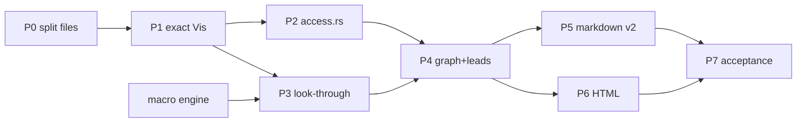

## Goals and decisions

- **Markdown:** compact, rich data, so a model sees the crate's structure and gets leads for improving it and removing slop.
- **HTML:** a clear, simple page with hierarchy and no repetition. It shows modules, symbols, and visibility, so a person can see what to simplify, hide, or restructure.
- **Decided with you:** the body is module-major. Inside a type, data comes first, then functions, and each part is grouped by visibility with its keyword.

## Rules for every phase

- Land code, goldens, docs, and tests in one commit per phase. `src/leads_tests.rs:245-283` pins the glossary tag, the glossary order (equal to `leads::ids()`), 7 headings, and one `Wrong when:` and one `Verify:` per entry. So a lead and its glossary entry ship together.
- Per AGENTS.md, read every golden diff and never regenerate goldens to pass. There are 59 markdown and 59 HTML goldens today, and 61 of each after this plan.
- `build/structure.rs:134` caps every `.rs` file at 500 lines, counting blank lines. Put new logic and new tests in new files.
- MSRV is 1.85, so no let chains.

## Phases and lanes

The macro engine has no dependencies, so it starts on day one. Phases 2 and 3 run in parallel after phase 1. They meet only in `analysis_items.rs`, in different functions, and phase 4 needs both: `eff` and `need` from phase 2, and the virtual-file registration from phase 3. Phases 5 and 6 also run in parallel: they change separate goldens (`.md` and `.html`) and separate code, and both read access from the analysis run and `Meta`. Phases 0, 1, and 2 change no output, so their review cost is low.

## Phase 0: make room (no output change)

- Split the files at the cap before any edit:
  - `layout.rs` (500 lines): move lines 61-66, 251-338, and tests 427-500 to `src/layout_groups.rs`.
  - `render_html.rs` (479): move lines 17-25, 192-348, and 415-444 to `src/render_code.rs` as `impl Page`, as `render_spans.rs` already does.
  - `model.rs` (486): move `MacroKind`, `Holder`, and `MacroUse` (363-389) to `src/model_macro.rs`.
  - `collect.rs` (467): move `item_macro`, `finish_invocations`, and the attribute-mark functions (232-290, 332-342, 413-445) to `src/collect_macro.rs`.
  - `modtree.rs` (499): move the path helpers (270-362) to `src/modtree_paths.rs`.
- Delete dead code: `Order.namers`, `Namers`, and `namers()` (`order.rs:25, 28-34, 76, 114, 158-188`).
- Return `run.surfaces` from `analyze` and delete the second walk at `pipeline.rs:87-91`. Assert that they match first.

## Phase 1: exact visibility (no output change)

- In `model.rs:63-72`, define `Vis { Public, Crate, Super, In(ModId), Private }`.
  - `In` holds the resolved ancestor, so `Vis` stays `Copy` and about 30 by-value uses still compile.
  - Drop `PartialOrd` and `Ord`, so the compiler finds every comparison.
  - `Meta.vis` keeps the written spelling.
  - `attrs::vis` maps syn exactly. Every module exists before items are collected (`collect.rs:91-116`), so `In` resolves at collection.
- Make `Module.vis` exact (`collect.rs:312-313`). Add `Module.parent`, set from `ModSource.decl` at `collect.rs:92-110`. `Crate::parent_module` (`model_impl.rs:125-128`) reads that field, which fixes the cfg-twin parent bug.
- Add `Impl.module` (`model_impl.rs:57`), set at `collect_impl.rs:117-130`.
  - Delete `leads_items::impl_module` (364-370) and repoint its four callers: `leads_items.rs:376`, `leads_names_modules.rs:90`, `leads_census_scope.rs:165`, and `render_slop_decl.rs:35`.
  - `impl_home` keeps its declaration-first rule.
- Give tuple-field `Param` a `Vis` at `collect_field.rs:94`, and delete `vis_of` (`leads_items.rs:353-360`).
- Set owner visibility:
  - Variants and variant fields take the enum's (`leads_docs.rs:278`, `leads_items.rs:232`, `leads_census_scope.rs:146`, `analysis_items.rs:381`).
  - Trait methods take the trait's (`collect_impl.rs:312`).
  - Trait-impl members, macro marks, and unsupported items keep placeholder values (`collect_trait.rs:283`, `collect.rs:285, 325`, `collect_use.rs:281`). Every visibility consumer skips them by kind.
- Keep phase-1 output identical. A temporary rank helper maps `Crate`, `Super`, and `In` to today's `Internal` for:
  - the four order comparisons (`leads_shapes.rs:305`, `leads_body.rs:164`, `leads_items.rs:459`, `leads_names.rs:380-384`)
  - the layout map key (`layout_items.rs:25`)
  - the markdown counts (`render_slop_items.rs:90-107`)

  Phases 4 to 6 remove the helper.

Confidence: high, because every input exists at collection time and the output stays unchanged.

## Phase 2: effective visibility in src/access.rs

- Name the type `Access { World, Within(ModId) }`. `Scope`, `World`, `reach`, and `Reach` already exist (`resolve.rs:42`, `resolve_run.rs:24`, `order_graph.rs:157`, `text.rs:157`).
- **Written access:** `Vis` resolved against the declaring module: the impl's module for members, and the parent for modules.
- **`eff`:** a fixpoint walk from the root that re-enters a module only when its access widens.
  - An item's path access is its module's path access, narrowed by the item's written access.
  - A re-export in `r` with visibility `V`, of any spelling, gives its target `access(r) ∩ written(V) ∩ written(target)`.
  - A glob does the same for each item visible at `r`.
  - `eff` is the join over paths, so it never exceeds the written access. A member's `eff` is its type's `eff` narrowed by its own written access.
  - Precompute child lists from `Module.parent`, because `surface.rs:212-220` rescans every module.
- **`need`:** the narrowest access the observed uses allow. Only `visibility-slack` uses it, and it is never printed as a field.
  - It is the lowest common ancestor of the item's module and its own-target production uses. A use with no module, such as one in a `cfg(test)` file, counts as `Within(0)`.
  - It is at least the access of every explicit re-export of the item (E0364), and at least the `eff` of every signature that names it (`private_interfaces`). Every lexical hit must fall inside it, which is the old lead's guard.
  - It covers types, free functions, constants, statics, static methods, and associated constants. Modules, fields, and dot-called methods are left out, because those uses are not resolved.
- **Where it lives:**
  - Fields on `AnalysisRun`, built after `run.observe()` and returned through `Analyzed` and `Parts` to `document::Inputs` (`pipeline.rs:151-158, 234-241, 254-261`).
  - After `analyze` returns, write each node's written access and `eff` into its `Meta` before `attach` (`pipeline.rs:84`). Layout then needs no new parameters, and members keep their impl's access after attach empties the impl.
- **Surface:**
  - The library surface becomes "`eff` is World". That replaces `surface_items` (`analysis_items.rs:213-255`) and its bug: `pub(crate) use m::other as run;` puts `m::other` on the surface.
  - `surface::walk` keeps producing the paths, with a `ValueRef` in `Found` and `Kind` (`surface.rs:24-44`), so values link exactly (`document_surface.rs:38-43`).
  - Pin "walk paths equal `eff` World" in `check_docs` (`analysis_check.rs:239-256`), for libraries only. Binaries have no surface (`analysis.rs:252-271`).
  - `pub-off-surface`, `hidden-non-exhaustive`, and `thin-wrapper-one-observed-user` keep `on_surface`.
- **Tests:** `src/access_tests.rs`, because `analysis_tests.rs` is at 415 lines. Cover `pub(super)` at depth 1 and 2, a `pub` item in a private module, a root re-export, a `pub(crate) use`, a glob of a restricted item, an impl in another module, and `need` with each guard.

Confidence: high on `eff`. Medium on `need`, because method calls are unresolved.

## Phase 3: macro look-through for item-position `macro_rules!`

**Engine (parallel lane):**
- `src/macro_rules.rs` splits a definition into rules.
- `src/macro_match.rs`:
  - matches literal tokens, and fragments parsed by syn from the remaining tokens: `ident`, `lifetime`, `literal`, `vis`, `tt`, `ty`, `path`, `expr`, `pat`, `pat_param`, `stmt`, `block`, `item`, and `meta`
  - handles `*`, `+`, and `?` repetitions, nested
  - backtracks under a step budget; the first full match wins
- `src/macro_transcribe.rs` substitutes captures by repetition depth, including a depth-0 variable inside a repetition (`event.rs:97`), and turns `$crate` into `crate`.
- Limits: depth 128 (rustc's default) and an output size cap. Unit tests go in their own files.

**Pre-pass,** in `collect::collect`, before `Collector` borrows `files` and builds `pools` (`collect.rs:72-75`):
- Gather definitions from the parsed `ModSource.items` (`modtree.rs:23`), skipping test-only ones.
  - A name resolves to the crate's unique definition, else the nearest ancestor module's, else it warns.
  - Textual order is ignored, so the result is deterministic.
- Expand each item-position invocation that is not test-only, expanding nested item invocations in place. Parse the result as `syn::File`.
  - Reject an expansion that writes a `mod` item, because `collect.rs:296` keys child modules by item index.
  - Print the rest with `prettyplease::unparse`. prettyplease 0.3.0 needs `syn` ^3 and MSRV 1.71; I checked this on crates.io on 2026-11-01.
- Append one virtual `SourceFile` per invocation, with its comment pool, and `origin: Some(Origin { loc, module, via })` (`source.rs:9-30`). Its `rel` is the invoking file's, so doc includes and warnings name real files (`comments.rs:166-172, 265`).
- `item_macro` collects the virtual items into the invoking module, with the invocation's cfgs so test-support marking holds (`test_support.rs:33-35`). It keeps the mark and the `MACROS:` entry, and skips end marks on the declarations it wrote (`collect.rs:334-342`).

**Locations** stay virtual inside the model, because the debug validators need them (`collect_check.rs:63-68, 88-98`). One `Crate::real_loc` maps through `origin`, before any dedup, at every output:
- markdown: `Outline::loc` and its sort rank (`render_slop.rs:87-108`), and impl locs (`render_slop_decl.rs:282-285`)
- leads: `Lead::at`, before `settle` dedups (`leads.rs:133-172`)
- HTML:
  - `Builder::link` (`document_sections.rs:124-132`)
  - member links (`pipeline.rs:120-123`)
  - the kill-list sort (`document_kill.rs:61-65`)
  - the impl dedup (`document_sections.rs:168-175`), which must merge members before deduping
- stderr warnings (`collect.rs:405-411`)

`impl-spread` and `direct-impl-field-split` group by the origin file (`leads_names_modules.rs:44-48`, `leads_shapes_impls.rs:146-152`).

**Census and analysis:**
- A virtual file keeps a census source with no tokens (`census_sources.rs:43-63`), so `tree[t] + f` stays aligned (`census.rs:156-158`) and `census_check` passes (30-43).
- `declarations()` skips nodes in virtual files (`census_sources.rs:218-279`). Otherwise the declaration check fails on stamped fields.
- `analysis_items::scopes` registers each virtual file under its invoking module (150-156).
- References in virtual files get `written: None` (`typerefs.rs:239-245`). Spellings, external counts, and the unresolved tally then count each written name once.

**Leads,** handled centrally in `leads.rs`:
- Append the macro name to the evidence once.
- Drop twin and repeat leads whose subjects all come from one expansion: same-shape, contained-shape, generic-twin, mirror-enum, spelling-table, param-clump, body-clone, repeated-literal, and repeated-number.
- `Docs::new` (`leads_docs.rs:133-177`) counts identical docs with one `via` as one site. Otherwise `events!`'s stamped `section` doc makes a 56-subject `repeated-doc-text` lead.

**Outputs:**
- markdown: `via` on top-level records only, derived from the location's file
- HTML: "written by `events!`" inside `
`
- stderr: ``warning: <file>:<line>: macro `name!` not expanded: <reason>``

**Docs:** README.md:14, 20, 166, 180, and 277. tools/vibelight.md:76, plus one lens sentence defining "macros" as every macro except the crate's own item-position `macro_rules!`, which replaces about a dozen glossary edits. Also tools/vibelight.md:558, 599, and 728, so the analysis, verify, and refine subagents handle `via`.

**Tests:**
- Add a `macro-expansion` fixture with:
  - an `events!`-shaped macro with a stamped field doc of 8 or more content words
  - recursive `@` rules
  - a macro defined in another file
  - an invocation that matches no rule
- The `kill-list` golden changes, because `constant!(ONE)` now expands. The `macros` golden stays the same.
- Make `links`' `noop` macro write an item, so the raw golden pins "written by"; the normalizer drops source lines elsewhere (`support.rs:436-438`).
- Add the new warning to `WARNINGS` in `tests/it/goldens.rs:17-33`.

Confidence: medium-high for `events!`, because its rule is simple. Medium for macros in general, because there are no ambiguity checks, so an unusual macro warns rather than expands.

## Phase 4: module graph and leads

- **Graph:** `src/module_graph.rs`, a field on `AnalysisRun`.
  - Edges come from production, same-target uses that are not doc links. Each edge counts distinct items, not duplicate hits, and nested pairs are dropped.
  - Fix `census_paths.rs:56-79`, which reads the `crate::a` in `pub(in crate::a)` as a use of module `a`.
- **`module-cycle`:** runs on the graph with `strongly_connected` (`order_graph.rs:172`). Delete `leads_names_modules.rs:211-222` and 246-258, and the `module_at` import. The lead is lexical when any cycle edge is a census path.
- **New leads,** in glossary order, each with its entry:
  - **`visibility-spelling`** (names group, `leads_names_modules.rs`): a written spelling that differs from the canonical spelling of its resolved access, such as `pub(super)` at depth 1, or `pub(in path)` naming its own module or its parent.
  - **`pub-mod-surface`** (names group): a `pub mod` on a library's surface, outside test support. A `pub mod` off the surface stays `pub-off-surface`.
  - **`visibility-slack`** (census group):
    - It takes the slot of `no-observed-outside-module-use` (`leads_census.rs:32`), and `leads_census_reach.rs:76-116` is deleted.
    - It fires when `need` is narrower than `eff`, and skips library-surface items and items that `pub-off-surface` already flags.
    - It is lexical when any use is a census path.
    - Add `method-calls` to `LIMITS` (`leads.rs:35-42`), and update `leads_census_tests.rs:185-201`.
- **Comparison rules,** within one target only (an item of another target counts as World):
  - `field-and-accessor` (`leads_shapes.rs:305`): the field must not be private, and the field's `eff` must contain the method's `eff`.
  - Seams: one shared helper for `leads_body.rs:164` and `leads_items.rs:459`. A call is a seam when the function's `eff` is strictly wider than its callee's.
  - `wrapper-name-family` (`leads_names.rs:380-384`): a sibling is exempt when its `eff` lies strictly inside `x`'s.
  - Equality checks on `Public` and `Private` stay as they are: `leads_body.rs:195, 198, 326, 381`, `leads_census_paths.rs:148, 207, 336`, and `leads_docs_phrases.rs:179`.
  - Add a forwarder seam test: a `pub fn` in a private module over a `pub(crate) fn`. Keep `leads_body_tests.rs:49-50` passing.
- **Docs:** tools/vibelight.md:218-219 (the Placement and Visibility kinds), 350-361, 431-437, and 455.
- **Fixtures:**
  - Add `visibility-scopes`, with only the cases no fixture covers: depth-2 `pub(super)`, `pub(in crate::a)` naming the parent, a `pub(in ...) use` as the only path, an impl in an inline sibling module with `pub(super)` and private methods, and slack items with real uses.
  - Put the graph case in `order-modules`: a body call that closes a cycle no `use` item writes.

## Phase 5: markdown schema 2

- **`modules` (line 3):** each item gains `vis` (the written spelling, left out when private) and `eff` (only when narrower than written). It is the module tree with visibility.
- **`mod`:** drops `vis` and `functions`. It gains the counts `types`, `functions`, `values`, and `reexports`, and `mix`, a count per written visibility that skips marks and unsupported items. Delete `VisCounts` (`render_slop_catalog.rs:18-28`, `render_slop_items.rs:84-97`).
- **`deps` (new, after `surface`):** one per module that uses another, as an array of `{path, n}` sorted by path, such as `{"k":"deps","path":"run","uses":[{"path":"model","n":2},{"path":"parse","n":4}]}`.
  - Arrays split into `more` records and maps do not (`render_slop_split.rs:200-202, 347-349`).
  - An array also avoids reserved keys such as `loc` (`render_slop_check.rs:321-337`).
- **Catalog records:**
  - `eff` appears only where a re-export makes it differ from "module `eff` narrowed by written access".
  - `via` appears on top-level records only.
  - No `need`, `ca`, or `children` fields: the first is the lead's evidence, and the other two can be derived.
- **Access spelling:** `pub` for World and `pub(crate)` for `Within(0)`, applied first. Then `pub(self)` for the declaring module, `pub(super)` for its parent, and `pub(in crate::a::b)` otherwise.
- **Check:**
  - Add `deps` to `section()`, and replace the literal catalog section `7` with a named constant (`render_slop_check.rs:256`).
  - Register `uses` as a sorted list, and delete the dead `"users"` key (`render_slop_check.rs:36`).
  - Make the caller of `render_slop_split::lines` fail on any line over 900 characters. That file is at 495 lines.
- **Schema sites to change:**
  - `render_slop_schema.rs:22`
  - `render_slop_tests.rs:53`, and 152, which becomes `broken("\"schema\":2", "\"schema\":3")`
  - `tests/it/cli.rs:60` and `tests/it/leads.rs:61`
  - `tests/it/workspaces.rs:358` and the `mod` line at 362
  - `src/leads_tests.rs:277`, together with tools/vibelight.md:223
  - tools/vibelight.md:104: write `"schema":2`. Today's `schema:1` text never matches the real JSON.
  - README.md:176 and 188
  
  Leave `src/folders.rs:181`, `tests/it/folders.rs:31`, and `tests/it/support.rs:374` at 1. Stale-outline detection reads only the prefix.
- **Docs:** README.md:154-166, 176-190, and 201 (recopy the example from the `links` golden). tools/vibelight.md:192 (already stale), 198-209, and 556.

## Phase 6: HTML

**Types:**
- Delete `is_class` (`layout_decl.rs:137-150`) together with `BodyParts.class` and the default-access rule (204-206, 255-272, `layout_items.rs:409`).
- `head_spans` prints the written visibility, then `struct`, `enum`, `union`, or `trait`, with any trait prefix after the visibility. Aliases and tuple fields print their visibility too (`layout_decl.rs:153-172`, `layout_head.rs:94-99`).
- Groups are keyed by `(rank, spelling)`: rank 0 for World, otherwise 1 plus the depth of the resolved module.
  - So `pub(super)` at depth 1 and `pub(crate)` print as two groups with the same rank, which is exactly what `visibility-spelling` flags.
  - An unlabeled first slot holds variants, trait items, marks, and unsupported lines.
  - `join_sections(data, members)` prints `spelling:` for every labeled group, data first, then functions. Special members go under the type's own label.
  - Access is read from `Meta`.
- In module blocks (`layout_items.rs:19-101`), items get the same labels. Delete `visibility_line` (`layout_decl.rs:78-92`). Each extern block prints once, with its items labeled inside its braces.
- A dim `reaches <access>` note goes on its own line, so wraps don't change, and only when `eff` is narrower than written and its container doesn't show the same note.

**Body:**
- One section per module in `sorted_modules()` order (`document_modules.rs:8-16`). Reuse `module()` (`document_sections.rs:235-254`), adding the module's types from `sequence`, `unconnected`, and `test_support` (`order.rs:17-23`).
- Add to the document model:
  - spans in `Node::Heading`, for the dim breadcrumb through `Span::Dim`
  - a text node for the anatomy line
  - `via` on `SourceLink`
  - an emphasis flag on `Inline::Anchor` for bold surface names; `Inline::Bold` is the MACRO badge
- Build `value_ids` before the `Builder` (`document.rs:198`).
- The ids `group.N`, `test-support`, `unconnected`, and `modules` go away, and `macro.N` renumbers.
- Delete:
  - `groups.rs`, `grouped`, `group_item`, and `captions`
  - `section_item`, `section_start`, and `module_path`
  - `Node::Rule` (`document.rs:82-83`, `render_html.rs:132`, `render_style.rs:12, 69-72`)
  - `mod groups` (`main.rs:50`)
  
  Retire or repurpose the `struct-class` and `order-groups` fixtures.

**Sidebar:**
- The tree comes from `Module.parent`. Symbols are ordered by `path_order` (`model.rs:453`): types through `decl_ids`, and functions, constants, and statics through `value_ids`.
- Extern items and macros are not listed.
- Surface names print in bold.

**Legend and docs:**
- `legend.rs` lines 9, 12, and 13.
- README.md:14-15, 140-152, 203-256 (including 225, 246, 248, and 254), and 260.
- AGENTS.md:2 becomes "a C++ header that uses Rust's item keywords and visibility labels".

**Tests:**
- Update the `layout_head.rs` tests at lines 180, 192, and 216.
- `tests/it/workspaces.rs:206-211` counts only cross-page value links.
- `tests/it/arrange.rs:305` moves only impls whose members are all `pub` or `pub(crate)`.

## Phase 7: acceptance on runvil

Run from the `runvil` root into a scratch folder. The run covers the whole workspace because of runvil's config, and the scratch folder keeps everything out of the repo.

**runvil-prompt:**
- `visibility-spelling` fires on the 8 `pub(super)` items. The 6 in `fence` become one summary, and the 2 in `list` stay separate leads.
- `pub-mod-surface` fires on `detail`, whose `modules` item shows `"vis":"pub"`.
- `pub-off-surface` stays at 0, and stderr has no new warnings.

**runvil-types:**
- The outline has `pub enum Event` with its 56 variants, each with `execution`, `section`, and `provenance` first, plus the three accessors. The top-level records have `"via":"events!"`.
- `Event` has a `wire-keys` record.
- `Event` links in the types page and the engine page.
- There is no `repeated-doc-text` lead on `Event::*::section`. There is one lead pairing `Event`'s doc with the module doc (`event.rs:32-34` and 155-157).
- runvil-types' count of unresolved type names drops. The tally is per crate and taken before cross-crate linking.

## Defaults (say if you want them different)

- The private group label is `pub(self):`. The alternative is `private:`.
- Labels show the written spelling.
- `visibility-slack` replaces `no-observed-outside-module-use`. A `quiet` entry naming the old id becomes a `note:` line.
- Look-through covers the crate's own item-position `macro_rules!`. Nested invocations are expanded in place, and `via` names the top-level macro.

## Deferred

- A layer config and a deny gate.
- Modularity Q, Louvain or Leiden, and min-cut.
- Exported macros used from other crates of the run. This is feasible, because `crate_map` needs no crates, but every syn tree would have to be held at once.
- Impl-item, trait-item, and expression-position invocations, and procedural macros.
- The other C++ spellings (`using`, `static`, `constexpr`, `str&`).

## Execution note

Copy this plan to `plans/2026-11-01-visibility-structure-upgrade.plan.md` when work starts. Mark the todos completed and add an Outcome section at the end, per AGENTS.md.

## Outcome

- Phases 0 to 7 landed on `visibility-structure`, one commit per phase, with the macro engine in a commit of its own.
- Visibility: `Vis` is exact, `src/access.rs` computes effective access, and a library's surface is its nodes that reach anywhere. Leads compare reach instead of rank, and four leads are new or rebuilt: `pub-mod-surface`, `visibility-spelling`, `visibility-slack` (which replaces `no-observed-outside-module-use`), and `module-cycle` on the module graph.
- Markdown schema 2: the `modules` record carries `vis` and `eff`, `deps` records list which modules use which, `mod` records carry counts and `mix`, and catalog records carry `eff` and `via`.
- Macro look-through: the crate's own item-position `macro_rules!` invocations expand into virtual files. runvil-types now outlines `Event` with its 56 variants, and both its own page and runvil-engine's link to it.
- HTML: one section per module with a dim crumb and an anatomy line, Rust item keywords with the written visibility, members in labeled sections with data first, `reaches` notes, and a module-tree sidebar with surface names in bold.
- Acceptance on runvil holds, with one exception: runvil-types' unresolved type-name tally was already 0 before the change, because the tally never counted `Event`. Its pages went from no links to `Event` to 13.
- Deviations: `repeated-doc-text` counts the identical docs of one expansion as one site through its own site key, not in `Docs::new`. Headings carry a `crumb` string and anchors a `strong` flag instead of spans. The `struct-class` fixture became `visibility-labels`, and `order-groups` stays with a new crate doc.
- The goldens number 61 markdown and 61 HTML files.
