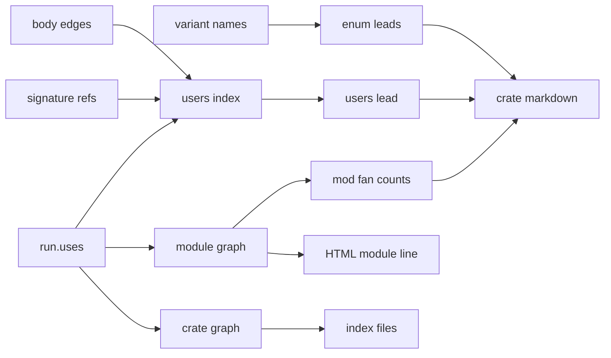

# Enum twins, module coupling, and a placement lead for vibelight

## Your questions, answered

- **A separate all-crates HTML page?** No. `html/index.html` already lists every crate, so the view of which crate uses which goes there, and `index.md` gets the same section. High confidence: a new page in `html/` would collide with each fixture's own page in the golden harness (`tests/it/goldens.rs:61-70`) and need special cases there.
- **How it shows in the HTML:** each module section gets one muted line under its anatomy line. It lists the modules this one uses and the modules that use it, each linked to its section with an item count, followed by the module's instability. Leads stay out of the HTML, as every lead is today. Medium-high confidence: the HTML is for browsing structure, and the leads are written for the model.
- **Markdown:** yes, per file. Each `mod` record gains `fan_in` and `fan_out`. Each new lead prints in every crate file it involves, the way cross-crate leads already do.
- **An index markdown for all crates:** `index.md` gets a "Uses between outlines" section. For each outline, it lists the outlines it uses and those that use it, with distinct item counts and instability.

## What testing on runvil changed

- **Enum rule:** a strict-subset test caught every real find:
  - the Effect family
  - `Blocked` inside `Parked`
  - `TaskPhase` inside `TaskState` and `EntryState`
  - `StateBucketError` inside `UserStateError`
  - `VfsError`'s 21 names inside `ErrorCode`

  A plain Jaccard cutoff can't separate the deliberate `Request`/`Answer` pair (0.72) from real near-copies (0.71). So the overlap rule counts the names the two enums don't share instead.
- **Placement rule:** counting edges in both directions flagged `Scheduler` as belonging in `error`, because it names six error types. Counting only an item's users, with a majority rule, gave 12 hits across 31 outlines.
- These estimates come from scripts over the runvil outlines stamped 2026-11-03 03:32 PST. runvil has new commits since then, so Phase 5 measures against a fresh baseline.

## Data flow

Every input already exists in `AnalysisRun`. The new plumbing is:
- the per-target graph, carried out of `analyze()` for the HTML in 2b;
- the crate graph, carried out of `analyze()` for the index in 4;
- `decl_texts`, which has to leave the markdown renderer in 3.

Phases 1, 2a, 3, and 4 don't depend on each other in code; 2b needs `used_by` from 2a. They land in order anyway, because each phase's goldens include the output of the phases before it.

Two agents can work in parallel lanes:
- **Lane A:** Phase 1, then Phase 3 (the leads).
- **Lane B:** Phases 2a, 2b, then 4 (the coupling).

The lanes share only `src/main.rs`, `src/render_slop_tests.rs`, and `tools/vibelight.md`, each in different places. After rebasing one lane onto the other, re-read the goldens of the two new fixtures, because both lanes change them.

## Rules for every phase

- Work on a new branch, `enums-and-coupling`, off `master`. Today `master` is clean and even with `origin/master`. Push only when you say so, and never push a tag (AGENTS.md).
- Make one commit per phase, holding its code, tests, goldens, and docs. A last commit records the plan copy's Outcome, as `e716ac1` did for the visibility work.
- A lead ships with its glossary bullet at the same position as its `IDS` slot. `src/leads_tests.rs:261-302` pins that order.
- Read every golden diff, including diffs in existing goldens that a new lead or field reaches. Never regenerate goldens to make a test pass ([vibelight/AGENTS.md](vibelight/AGENTS.md)).
- A new fixture needs two things:
  - an entry in `goldens!` (`tests/it/goldens.rs:100-153`);
  - a higher markdown golden count, which `src/render_slop_tests.rs:418-425` asserts (61 today, with a message that counts them).
- Every `.rs` file is capped at 500 lines, test files included (`build/structure.rs:129-142`). Files near the cap: `leads_shapes_twins.rs` 489, `analysis_check.rs` 486, `render_slop_tests.rs` 473, `leads_names.rs` 468, `leads_items.rs` 464.
- A new `src` file starts with a `//!` line (`build/structure.rs:17`) and gets a `mod` line in `src/main.rs`.
- MSRV is 1.85, so no let chains.
- After each phase, run the gates in `.github/workflows/ci.yml`:
  - `cargo fmt --check`
  - `cargo clippy --all-targets --locked`
  - `cargo test --locked`
  - `cargo +<rust-version> check --all-targets --locked`
  - `cargo package --locked`
- When work starts, copy this plan to `plans/2026-11-03-enums-and-coupling.plan.md`.

## Phase 1: enum set leads (markdown only)

- **Shared grouping:** add [vibelight/src/leads_shapes_enums.rs](vibelight/src/leads_shapes_enums.rs) with `pub(crate) fn name_sets(run)`.
  - It returns every enum in the run under its sorted variant names, built exactly as `mirror_enum` builds its key today (`src/leads_shapes_twins.rs:376-387`), but without the size filter.
  - `mirror_enum` calls it and keeps only the keys with at least `MIRROR_FROM` names, so its output doesn't change.
  - The new detectors treat each key as a set, with duplicates removed.
- **`contained-enum`:**
  - It looks at each name set of at least 3 names, and at the enums anywhere in the run whose name sets strictly contain it.
  - It writes one lead per small set. The subjects are every enum with that set and every enum that contains it.
  - The evidence names the shared variants and what each containing enum adds: up to three names, otherwise a count, such as "adds 47 more".
- **`near-mirror-enum`:**
  - It looks at pairs of name sets where neither is inside the other and they share at least 3 names.
  - It fires when the names in only one of the two sets number at most 2, or at most one in five of all the names in either set.
  - It writes one lead per pair of sets. The subjects are every enum with either set. The evidence names the shared variants and what each side adds.
  - It skips a pair when both sets contain one set that a `contained-enum` lead reports, and leaves that pair to that lead.
- **Both leads:**
  - Use `Mode::DirectSyntax`, set no limits, and look across the whole run, as `mirror-enum` does.
  - Join `TWINS` (`src/leads.rs:104`, so the array grows from 9 to 11). That keeps one macro expansion's own enums from firing them.
- **Registration and docs:**
  - Add both ids right after `mirror-enum` in `IDS` (`src/leads_shapes.rs:49`).
  - Call the new file from `leads_shapes::find` (74-86) and add it to the import at line 16.
  - Add glossary bullets after `mirror-enum` in [vibelight/tools/vibelight.md](vibelight/tools/vibelight.md) (line 255), and update the Duplication prose at line 215.
- **Tests** go in `src/leads_shapes_tests.rs` (230 lines) and use `finds()`:
  - a subset hit, plus its near miss: equal sets stay with `mirror-enum`
  - a subset across two targets, using a `src/main.rs` in the test package
  - a near pair
  - a request/answer pair that differs by 5 names and must not fire
  - a near pair that is left to `contained-enum`
- **Golden:** add a new `enum-sets` fixture with a subset pair, a near pair, and a request/answer pair that must not fire. Raise the golden count to 62.

## Phase 2a: fan counts in the markdown

- **Graph helper:** in [vibelight/src/module_graph.rs](vibelight/src/module_graph.rs), add `used_by(graph)`. For one target, it returns the reverse edges with their item counts.
  - The `fan_out` of module m is `graph[t][m].len()`.
  - The `fan_in` of m is the number of modules whose edges include m.
  - A module and a module inside it never count, as in `deps`.
- **Markdown:**
  - `ModRecord` (`src/render_slop_catalog.rs:30-56`) gains `fan_in` and `fan_out` after `mix`, each left out when it is 0.
  - `module_record` (`src/render_slop_items.rs:85-114`) fills them from one `used_by` result computed per outline.
  - Scalar fields need no change to the schema check.
- **Tests:**
  - Put the `used_by` unit tests in a new `src/module_graph_tests.rs`.
  - Extend `the_outline_shows_the_module_tree_its_dependencies_and_what_reaches_further` (`src/render_slop_tests.rs:140-177`) to assert the fan counts of the modules on its `deps` line: `engine::run`, `engine::parse`, and `store`.
  - Update `tests/it/workspaces.rs:360` if its line changes.
  - Read each markdown golden whose modules use each other.
- **Docs:**
  - README:173, the `mod` record in "The catalog" bullet.
  - tools/vibelight.md:198 (the record description) and 565 (how to read structure): define `fan_in`, `fan_out`, and instability as `fan_out / (fan_in + fan_out)`.

## Phase 2b: the coupling line in HTML

- **Data path:**
  - `Analyzed` (`src/pipeline.rs:151-162`) gains a copy of `run.graph`.
  - `Parts`, `document::Inputs` (`src/document.rs:142-150`), and `Builder` (`src/document.rs:125-137`, set in `build` at 153-170) each gain the target's slice of it.
- **The line:**
  - `module_section` (`src/document_body.rs:68-104`) adds a new `Node::Line { class: "coupling", inlines }` right after the anatomy note (94-97), for any module with at least one edge.
  - It reads as two sentences and a number. Each sentence is left out when its list is empty. For example: `Used by 2 modules: vm (3), coro (1). Uses 13 modules: error (4), messages (2), and so on. Instability 0.87.`
  - The count in parentheses is how many distinct items the using module takes from the used one.
  - Lists go in module path order, and instability has two decimals.
  - Each name links to its module's section through `Builder.mod_ids`, which `build` fills before any section is built.
  - Render the node in `src/render_html.rs`, and add `.coupling` to the muted rule (`src/render_style.rs:22`).
- **Legend:** add one line to `src/legend.rs`, or a clause to its first line. Either way, every HTML golden changes by that text.
- **The HTML still depends only on its own crate and the crates it links to:**
  - The graph reads only the target's own production code.
  - Its qualified paths match only within `reach[t]` (`src/analysis_uses.rs:95-99, 222-229`). That's the target plus its `analysis_deps`, the same map that resolves links between pages.
  - These tests must pass unchanged: `tests/it/exclude.rs:44-87`, `tests/it/workspaces.rs:88-112`, and `tests/it/stamp.rs:108-131`.
- **Moving an impl changes the coupling line.** The line counts uses by the module where the code is written, just as source links name the file. Decided on 2026-11-03:
  - The page comparison in `tests/it/arrange.rs` ignores coupling lines, as it ignores source links.
  - The goldens still pin every coupling line exactly.
  - The README says the line follows where code is written.
- **Docs:** README:156 (the module section bullet), README:271 (what the Legend covers), and a sentence in "The HTML notation" (216-274).

## Phase 3: `most-users-elsewhere`

- **Prep, with no output change:** move `decl_texts` (`src/render_slop_facts.rs:289-330`, private today) to `src/analysis_items.rs` (413 lines) as `pub(crate)`, and repoint its two callers (`render_slop_facts.rs:127` and `:337`). No lead imports a `render_slop` module today, and this keeps it that way.
- **Home:** a new file, [vibelight/src/leads_names_users.rs](vibelight/src/leads_names_users.rs), called from `leads_names::find` (`src/leads_names.rs:183-191`). Its id goes right after `module-cycle` in `IDS` (line 42).
- **Users index,** built once per run: each item's distinct users across every target.
  - Both sides roll up to an owner. An owner is either a type, together with its fields, its variants, and the members of its inherent and trait impls (through `run.attached`), or a module-level function, constant, or static. A member of an impl with no attached type is left out.
  - Body paths come from `run.edges`, counting both `item` and `prefix`. The user is the owner of `run.body_items[target][body]`.
  - Signature users come from walking each target's `decl_texts` and its module items' texts (`order::item_texts`). Each ref is resolved with `run.item_of_ref(target, r)`, as `tied()` does (`src/leads_census_place.rs:143-147`). Comment refs are skipped.
  - An owner never counts as its own user.
  - Type names in bodies (`UseKind::Body`) have no recorded user, so each module that holds such uses counts as one more user in that module. Without this, an item that its own module names only inside bodies would look unused at home.
  - Census qualified paths don't count.
- **Rule:**
  - It applies to a type, or a module-level function, constant, or static, in module A that isn't test support and isn't in the crate root.
  - "Near A" means A itself, every module inside A, and every module around A up to the crate root.
  - The lead fires when one module B that isn't near A holds at least 3 of the item's users. B must also hold more users than all the near modules together, and more than half of all the item's users.
  - Users in other targets count toward that total, so a type that other crates use widely doesn't fire.
- **Lead details:**
  - `Mode::DirectSyntax`, with the limits `macros` and `method-calls`, plus `external-consumers` when `run.on_surface(item)`.
  - The evidence names module B, the counts, and up to three of the users in B.
- **Overlap with `defined-away-from-observed-users`:** `fold` (`src/leads.rs:329-341`) also drops this lead when a `defined-away-from-observed-users` lead has the same subject. That lead's only subject is its item (`src/leads_census_place.rs:269-270`).
- **Docs:** a glossary bullet under Names and placement, right after `module-cycle`, and the Placement prose at tools/vibelight.md:219.
- **Tests** in `src/leads_names_tests.rs` (288 lines):
  - a hit
  - only 2 users elsewhere: no lead
  - users split 2/2/2 across modules: no lead
  - heavy use from another target: no lead
  - an item that its own module names only in bodies, and that 3 functions elsewhere call: no lead
  - every user in one module, where `defined-away` fires: only that lead
- **Golden:** a new `module-users` fixture. Raise the golden count to 63. The fixture also pins the fan counts from 2a and the coupling line from 2b.

## Phase 4: uses between outlines in the index files

- **Crate graph:** add `module_graph::crates(run)`. For each target, it returns the other targets whose items that target's production code uses, with distinct item counts.
  - It keeps the uses that `build` drops only because they cross targets (`src/module_graph.rs:35-39`): production code only, with doc links left out.
  - Store it on `AnalysisRun` beside `graph` (`src/analysis.rs:304`).
  - Add it to the `lens` check in `src/analysis_check.rs:88-106`. That's one line, and the file is at 486.
  - Pass it out through `Analyzed`.
- **Index entries:** `index::Entry` gains `uses` and `used_by`, as stems with counts. They're filled in `outline()` (`src/pipeline.rs:110-116`).
  - `render` adds a `## Uses between outlines` section after the list, but only when some outline uses another. It has one line per such outline, in target order, such as ``- `runvil_engine` uses `runvil_lua` (N items), `runvil_types` (N items); used by `runvil` (N items); instability 0.67``.
  - `render_html` adds the same list, with each name linked to its page.
  - The first list stays exactly as it is, because tools/vibelight.md reads it.
- **Tests:**
  - The `src/index.rs` unit test: its entries gain empty lists, and its expected text stays the same.
  - A new unit test for the section.
  - The substring checks in `tests/it/cli.rs:97-122` and `tests/it/config.rs`.
  - The pinned `cross == 11` in `tests/it/workspaces.rs:284-287`, which goes up by the number of new index links.

  No new files are written, so the counts of written files stay the same.
- **Docs:** the README's "The folder" section (130-143), and tools/vibelight.md lines 102, 108, 111, and 118.

## Phase 5: acceptance on runvil

- **Compare against a baseline on the same runvil commit:**
  - Build `master` and the branch.
  - From the runvil root, run each build with `-o` into its own scratch folder outside both repos.
  - Diff the two folders. That separates this work's changes from runvil's own, since runvil has moved on since the outlines behind the estimates above.
- **Expect these in the diff:**
  - **`contained-enum`:**
    - the Effect family
    - `Blocked` in `Parked`
    - `TaskPhase` in `TaskState` and `EntryState`
    - `StateBucketError` in `UserStateError`
    - `VfsError` in `ErrorCode`. runvil's rules allow this one, so it's a candidate for `quiet`.
  - **`near-mirror-enum`:** `ConnectionProbe` with `ConnectionAttempt`, and nothing for `Request` with `Answer`.
  - **Coupling:** runvil-lua's `error` mod record has a `fan_in` near 44 (44 in the 03:32 outlines), and its HTML section lists the same modules.
  - **`most-users-elsewhere`:** on the order of 10 leads across the run. Read each one.
  - **Index:** `index.md` shows `runvil_engine` using `runvil_lua`.
- **Expect nothing else:** no changed records beyond the fan fields, the new leads, the coupling lines, the legend, and the index section, and no new warnings. Treat any other difference as a finding to read, not one to force away.

## Decisions after the runvil acceptance run (2026-11-03)

- **What the run showed:**
  - The branch matched master except in the planned ways, at the same speed.
  - Both enum leads and the coupling numbers were exact.
  - `most-users-elsewhere` fired 19 times with 2 real hits.
  - The index made runvil's facades look unused.
- **Index:** a use of an item declared in a crate the user doesn't depend on counts for the user's dependency that re-exports it. The first such dependency in target order wins, and the declaring crate is the fallback. This amends the Phase 4 commit.
- **`most-users-elsewhere`:**
  - Skip items on a library surface or reached by any re-export.
  - Require 4 users instead of 3.
  - Count each impl member as its own user, placed at its type's module, so a type's methods outweigh scattered free functions. A type's own members never count as users of it.
  - These changes fold into the Phase 3 commit.
  - Re-measure on the same snapshot. If most hits are still deliberate placements, drop the lead.

## Defaults (say if you want them different)

- **Lead names:** `contained-enum`, `near-mirror-enum`, and `most-users-elsewhere`.
- **No instability field in the markdown,** only `fan_in` and `fan_out`. The HTML and the index print instability. Medium confidence: it would be the schema's first float, and it follows from the two counts.
- **No schema version bump.** Medium confidence: the new fields are optional and only add data.
- **The placement lead counts who uses an item, not what the item uses.** High confidence: the both-directions version pointed everything at `error`.
- **Type names in bodies count as one user per module.** Medium confidence: it prevents false hits on items their own module names only in bodies, but it undercounts a module that names the item in many bodies.

## Deferred

- A lead for dependencies that point from a stable module to a less stable one. runvil-lua has 16 such edges.
- Comparing payload types in the enum leads.
- Louvain or Leiden, betweenness, articulation points, and min cut.
- Showing leads in the HTML.

## Outcome

- **Landed on `enums-and-coupling`, as four commits:**
  - `6d3be88` adds `contained-enum` and `near-mirror-enum`.
  - `2900990` adds `fan_in` and `fan_out` to `mod` records.
  - `ae0c479` adds the HTML coupling line and its legend line.
  - `b7f72da` adds the "Uses between outlines" section to both index files.
- **Dropped: `most-users-elsewhere`.**
  - On runvil it fired 19 times with 2 real hits.
  - After tuning, it fired 16 times, still with 2 real hits. The tuning skipped surface and re-exported items, required four users, and counted members separately.
  - Most hits were documented layering, error builders, or shared vocabulary.
  - The work is kept on the local branch `most-users-elsewhere-experiment` (`73939eb`). There, `decl_texts` moved out of the markdown renderer; on this branch it stayed put.
- **Acceptance on a runvil snapshot** (`126a8eaa7` plus 53 uncommitted entries), comparing `master` with the branch:
  - `contained-enum` found exactly the five expected sets. `near-mirror-enum` found exactly `ConnectionProbe` with `ConnectionAttempt`, and nothing for `Request` with `Answer`.
  - 360 `mod` records gained fan counts, and 360 module sections gained coupling lines. All of them agree with the `deps` records. runvil-lua's `error` module has `fan_in` 44.
  - There was no unexpected record, page, or stderr difference, and no measurable runtime cost: about 4 to 5 seconds on both sides.
- **Deviations from the design:**
  - Moving code to another module changes the coupling line, just as it changes source links. So the page comparison in `tests/it/arrange.rs` ignores coupling lines, while the goldens still pin them.
  - The index credits each use to the crate that declares the item, when the using crate depends on it. Otherwise it credits the first dependency that re-exports the item by name, and failing that, the declaring crate. Facades such as `runvil` now show their users.
  - Every HTML page also changes one CSS rule, beyond the planned legend line.
  - The goldens number 62 markdown and 62 HTML files.
- **Found here but not fixed:**
  - The index rule doesn't follow glob, module, or whole-crate re-exports, so two runvil lines credit `workshop_gateway_discovery` through its alias.
  - A use through a re-exported enum variant, such as `pub use base::Shape::Circle;`, records no use.
  - A use of a module with cfg variants counts only for the first variant.
  - Debug builds abort on runvil with "the leads are not in order at a visibility-spelling lead", and on vibelight itself over census declarations of `macro_rules`. Both happen on `master` as well, so they predate this work.
