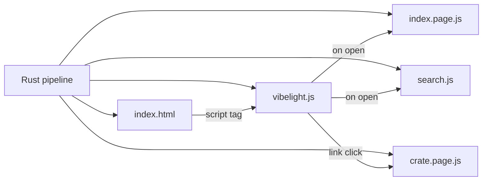

# Vibelight structure browser

## Purpose

The HTML exists to make the structure of vibe-coded code legible, so a reader can audit it without wading through implementation. Every decision below serves that goal.

The Cursor check is done. Your open tabs, such as `harness_runner.html#runvil_vfs/...` titled `runvil_vfs`, show that script-loaded pages work there.

## AGENTS.md ([vibelight/AGENTS.md](vibelight/AGENTS.md))

Add this as the first bullet:

> - The HTML exists to make the structure of vibe-coded code legible, so a reader can audit it without wading through a million lines of implementation. A page answers structural questions: what each crate is for, which crates are facades and which implement them, what a user of each facade can name, and where each piece is written. Every rendering choice serves that goal: show declarations and their comments, never bodies; put the public API first; make every item traceable to its file and line; and leave out anything that makes a page longer without making its structure clearer.

Replace the second bullet, the C++ header rule, with:

> - When a rendering case is not covered by a written rule, make each signature and shape in the markdown's records read like one line of Rust source with the bodies removed, and the HTML read like Rust source with the bodies removed: one merged impl per type, members from most visible to least, trait impls on one Implements line, and each item's file and line in dim text. A facade's page shows only what its users can name. A written rule always beats either look. Pin every such choice with a golden test.

## Shape

- [vibelight/src/index.rs](vibelight/src/index.rs) `render_html` becomes the app shell: head, CSS, script tag, and a `<noscript>` line. The per-crate `.html` files stop being written, and the next run removes the old ones.
- Data files are classic scripts:
  - `index.page.js` holds the root page.
  - `<stem>.page.js` holds each crate's page.
  - `search.js` holds the crate list and about 2,400 declaration records for runvil.
- Routes are `#<stem>/<id>`, and the root is an empty hash. The app intercepts `X.html#id` and `#id` links.

## Crate roles (new [vibelight/src/roles.rs](vibelight/src/roles.rs))

- Inputs already exist in [vibelight/src/pipeline.rs](vibelight/src/pipeline.rs): each target's `surface::Entry` list (`Kind::Cross` names the source crate), its `TargetKind`, and `analyzed.crate_graph`.
- **Facade:** a library where re-exports of other run crates are at least half of its surface items, with modules not counted.
- **Implementation:** a library that a facade re-exports from, recorded under each facade that fronts it.
- **Bypass:** a crate that depends on an implementation crate directly, without being one of its facades. Example: `runvil-plugin` uses `runvil-types` and `runvil-vfs` directly.
- **Other:** every remaining library, plus binaries (`TargetKind`).
- Override: a `facades = [...]` glob list, written the same way as `exclude`. It goes in `KEYS` and `Config` in [vibelight/src/config.rs](vibelight/src/config.rs) and in `Plan` in [vibelight/src/settings.rs](vibelight/src/settings.rs). When set, it replaces automatic facade detection.
- Expected results for runvil:
  - facades: `runvil`, `harness`, and `workshop-server-api`, the last because it describes itself as "re-exports only"
  - 10 implementation crates
  - 17 other crates
- Unit tests cover a clear facade, a mixed crate, a bypass, a binary, and the override.

## Rust rendering, every page

- Replace the C++ header layout in [vibelight/src/layout_decl.rs](vibelight/src/layout_decl.rs), `layout_head.rs`, `layout_members.rs`, `layout_groups.rs` and [vibelight/src/render_code.rs](vibelight/src/render_code.rs). [vibelight/src/layout_special.rs](vibelight/src/layout_special.rs), the C++ special members, goes away.
- Each type is written the way Rust writes it:
  - derives and attributes on dim `#[...]` lines
  - `pub struct Name { ... }`, with each member carrying its own visibility keyword
  - one merged `impl Name { ... }` holding every inherent method from all impl blocks
- Ordering:
  - members and methods go from `pub` to `pub(crate)` to narrower to private
  - within one visibility, source order
- Trait impls go on one dim "Implements Default, Debug, ..." line.
- Location tags:
  - each item has a dim tag on the right with its crate and `file:line`
  - each member has a dim `file:line` on the right, so merging impl blocks keeps every location
- Two views per module:
  - **At a glance:** one block for the whole module, signatures only, no comments, wrapped to the width rule. It reuses the one-line Rust text from [vibelight/src/render_slop_decl.rs](vibelight/src/render_slop_decl.rs) where it fits.
  - **Documented:** each item with its docs as prose above, and member docs as `///` lines.
- The Hide comments toggle goes away, because the at-a-glance view covers that need.
- The `reaches pub(crate)` dim marker stays.
- The Legend is rewritten for the Rust notation.
- The markdown doesn't change.

## Root page (index fragment, rendered in Rust)

This follows the mockups from this conversation, saved under `C:\Users\Vinnie\AppData\Local\Temp\cursor\screenshots\vibelight-mock-*.png`.

- Header: title, a paragraph on what this is and how to read it, and counts for crates, facades, implementation crates, other crates, and declarations.
- The Legend, once, as a compact box. It's removed from crate pages, so `head()` in [vibelight/src/render_html.rs](vibelight/src/render_html.rs) stops printing `doc.legend`.
- **Facades** table:
  - crate and folder
  - what it is: the first paragraph of its `//!` docs, falling back to the Cargo `description`
  - public API: item and module counts
  - re-exports from: one chip per source crate, with counts
- **Implementation crates** table, kept separate:
  - rows grouped "Behind runvil", "Behind harness", and so on
  - what it is
  - "N items of <facade>"
  - a warning line under any bypassing crate
- **Other crates** table: grouped by parent folder, with a bin badge on binaries.

## Facade pages

- A facade page shows only what a user of the facade can name. It's grouped by the facade's own modules (`runvil::`, `runvil::vfs::` and so on) and rendered with the same Rust renderer and the same two views.
- Re-exported items are pulled in from the crates that define them:
  - types through a new `Document::section(id)`
  - functions, constants and statics through a new `item_block(krate, ValueRef)` in [vibelight/src/layout_items.rs](vibelight/src/layout_items.rs)
- Pulled-in items keep only their `pub` members.
  - A type with no public fields shows `{ /* private fields */ }`.
  - `#[doc(hidden)]` items are left out.
- Each item's heading is the path as a user writes it, such as `runvil::Run`, followed by a dim "defined in runvil_engine::Run · src/execute/run.rs:109".
- Pulled-in nodes render through the owning crate's `Page` in a foreign mode:
  - in-page links become `<owner>.html#id`
  - headings take `api.<path>` ids
  - this touches [vibelight/src/render_html.rs](vibelight/src/render_html.rs) and [vibelight/src/render_spans.rs](vibelight/src/render_spans.rs)

## App ([vibelight/src/browse.js](vibelight/src/browse.js), plain JS)

- Top bar: a home link, tabs with close buttons, and search (Ctrl+K or `/`) over `search.js`.
- The content area holds the active page, with its module nav and main.
- Each tab keeps its own DOM and scroll position.
- Ctrl-click or middle-click opens a new tab.
- The hash holds the active tab, and `sessionStorage` holds the tab list when available.
- A missing data file shows a message.
- Each `.rs` link gets a "copy path:line" button, because Cursor's browser can't open source files.

## Tests and goldens

- Crate goldens become fragments: the mechanical strip of the head and body tags comes first.
- After that come the intended diffs, each read before it's accepted, as AGENTS.md requires:
  - the Rust rendering, which touches every golden
  - no Legend
  - facade views in the `garden` and `values` workspaces
- [vibelight/tests/it/support.rs](vibelight/tests/it/support.rs): `read_run` reads `<stem>.page.js` and returns it as `<stem>.html`. The direct page readers in workspaces, links, cli and stamp switch to it.
- New integration tests:
  - roles and bypass on `garden`
  - the `facades` override
  - `search.js` shape
  - shell contents
  - old pages removed on upgrade
- [vibelight/tests/it/browse.rs](vibelight/tests/it/browse.rs) is rewritten for the new layout.

## Docs

[vibelight/README.md](vibelight/README.md) gets:
- the purpose, as in AGENTS.md
- the app and its files
- roles and the `facades` key
- the root page
- the Rust rendering and its two views
- facade pages
- stamps and stale files for the new files

## Out of scope

- Roles in the markdown and `index.md`, which would be a schema change.
- Hover previews and split view.

## Verify

- `cargo fmt`, `cargo clippy --all-targets`, and `cargo test` in `vibelight`.
- Regenerate `runvil`, then check over a temporary localhost server in Chromium, and stop the server afterward:
  - the root page matches the mockups
  - the `runvil` facade shows only public items, and its links land
  - tabs, search, Back and Forward work
- You check the final version in Cursor.
- Nothing gets committed.

## Order

1. AGENTS.md first, since it sets the rule.
2. Roles.
3. The Rust renderer, which is the largest piece. Golden reviews run alongside it, fixture by fixture.
4. The root page and facade pages, which depend on roles and the renderer.
5. Output layout and the app, which can run alongside step 4 because the app works against today's `.page.js` files.
6. Docs and verification last.

## Outcome

Everything in the plan is built, and `cargo fmt`, `cargo clippy --all-targets`, and `cargo test` pass: 444 unit tests and 160 integration tests. All 62 HTML goldens changed, and each diff was read before it was accepted. No markdown golden changed. runvil was regenerated, then checked in Chromium over a temporary localhost server that was stopped afterward. The check covered:
- the overview
- the `runvil` and `workshop_server_api` facade pages
- an implementation page
- tabs, search, Ctrl-click, Back, and source-link copying

Where the build differs from the plan:
- **Member order inside one visibility:** members sort by name, not source order, because the arrange tests pin output that must not change when code moves. Fields and variants keep their declared order.
- **Location tags:** no dim `file:line` tag on the right. Every member name is already a link to its line, and a click copies `path:line`. A facade's items carry a dim `Defined in <path>, <file>:<line>` line under their heading.
- **The Implements line:** it is a `// implements Display, From<u32>` comment line after the type's blocks, and derives print as a dim `#[derive(...)]` line above the type.
- **Copying source links:** the source link itself copies `path:line` and shows a toast, instead of a separate copy button.
- **Facade pages:**
  - Declarations come from `public_block` and `item_block` in the defining crate, not from `Document::section`.
  - A renamed re-export prints under the name users write.
  - A link to an item the page shows stays on the page.
  - The search index lists the `api.*` headings, and search ranks a facade's item before the crate that defines it.
  - A facade's own declarations that its API leaves out lose their ids, so no link points at them.
- **Roles on runvil:** the result is 4 facades, `harness`, `runvil`, `runvil_plugin`, and `workshop_server_api`, with 25 implementation crates and 1 other crate, instead of the expected 3, 10, and 17. A facade's family is every crate its code reaches, so the plugin crates and the shared client crates land behind `workshop_server_api`, because the workshop server's code uses them. A half-facade is demoted to an implementation crate when another facade reaches it, all its users are in that facade's family, and it re-exports a smaller share. That rule keeps `workshop_server` out of the facades.
- **`pipeline.rs`:** its HTML helpers moved to `pipeline_html.rs` to keep each file under 500 lines.

Later the same day, at the user's request, the declarations went back to the C++-style form of the earlier release: a type's data members first, members under visibility labels, and the members of all its impls merged into one block. The `At a glance` view and the facade pages print the same blocks, and the Rust layout was removed. The documented code of every page that is not a facade's matches the earlier release's goldens byte for byte.

Known gaps:
- A whole module re-exported from another crate, such as `pub use workshop_server::discovery;`, shows as its `pub use` line rather than the module's items.
- The `facades` key can name facades, but it cannot mark a library as standalone, outside every family.
- The final look in Cursor itself is still yours to check.
