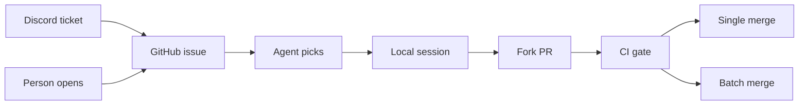

# How storytold vibes

Checked 2026-10-25 against the public storytold repositories, PhotoCraft at `938542c78`, and craft-contrib at `88cb930e`. The org has 68 public repositories: 30 in the Craft family, 26 older Unreal, mocap, and voice projects, and 12 others (forks such as egui and winit, plus training and infra). The vibe system is the Craft apps. The older repos have no `AGENTS.md`.

## Where the instructions live

Three layers. Only the first two are something you can copy from the public record.

**In the repo.** Each app's standing orders are a committed `AGENTS.md`. PhotoCraft's is the long form: what to read, how to pick work, the never-crash rules, parallel agents, the test gate, and contributor credits ([AGENTS.md](https://github.com/storytold/photocraft/blob/938542c78b5cdd6600ef70c3eb72a536a5d6c797/AGENTS.md)). Sibling apps repeat the same idea with drift. `CLAUDE.md` is usually a shorter copy, a one-line pointer ("Read AGENTS.md"), or a symlink. PhotoCraft has no root `CLAUDE.md`. Its `docs/user/CLAUDE.md` is one sentence telling Claude to read `docs/user/AGENTS.md`. `.coderabbit.yaml` is review policy only: skip Dependabot. It is not a coding prompt.

**GitHub Actions do not start the agents.** PhotoCraft's nine workflows, and the shared ones in [craft-common-actions](https://github.com/storytold/craft-common-actions), are CI, packaging, and release. `gate.yml` runs `cargo xtask ci`. Searches of those workflow files for `claude`, `codex`, `swarm`, and an agent launcher returned nothing. The only `cursor` hits are the X11 package names `libXcursor` and `libxcursor-dev`. Actions judge a pull request. They do not open one. PhotoCraft `ci.yml` says the token only checks out code, and `permissions` is `contents: read`. No workflow uses an `issues` trigger.

**Behind the scenes.** Two things are not in git, and a third is only half-published.

- Nothing public starts a session. The leftovers are branch names and commit trailers from Claude Code and Codex running on someone's machine, under a normal GitHub user account. `plan/` and `log/` are gitignored, so the session diary never lands on GitHub. `log/devlog.md` is not on PhotoCraft `main` (contents API 404).
- Private `craftrules` is still what the app manuals call the shared standard (`../craftrules/standards/never-crash.md`, fonts, the release playbook, `scripts/contributors.py`). `gh repo view storytold/craftrules` cannot resolve it. The contents API returns 404. Open issues [wordcraft#1160](https://github.com/storytold/wordcraft/issues/1160) and [lightcraft#1183](https://github.com/storytold/lightcraft/issues/1183) say the same 404. A code search of 199 files that mention `craftrules` did not find a file that calls it out of date. Nothing in craft-contrib, including every pull-request comment read on 2026-10-25, contains the word `craftrules`.
- The new cross-app rulebook is [craft-contrib/rfcs](https://github.com/storytold/craft-contrib/tree/main/rfcs), and it is early. The only RFC on `main` is the decision process. The other RFC texts are open pull requests. On several of those, the file and the later comments are different documents. The rationale you were pointed at is real, and most of it has not been merged.

You were told `craftrules` is stale and that the live rules are the RFC tree plus its pull-request comments. The public record supports the second half for proposals: comments hold decisions that were never edited back into the files. It does not support "craftrules is out of date." The coding standards (never crash, fonts, progress docs, the release playbook) are still cited as `craftrules` paths. They have not moved into craft-contrib. What has started to move is governance, and only RFC-0000 has landed. Confidence: high. The manuals, the 404, and the craft-contrib tree were all read on the same day.

## How a unit of work moves

There is no in-repo dispatcher that reads an issue and launches a swarm. The closest public proposal is [craft-contrib#11](https://github.com/storytold/craft-contrib/issues/11), which asks for a Hive hub that leases one issue to one contributor and names Claude Code, Codex, Goose, and other CLIs. It is an open issue, not an RFC, and it has no comments. [craft-contrib#19](https://github.com/storytold/craft-contrib/issues/19) describes a Python MCP gateway in front of 13 app servers and says an RFC for a "production agent" could be written later. No such RFC file exists.

What actually happens, from traced PhotoCraft issues:

1. A person opens a free-text issue, or the `ticket-craft` GitHub App files one from Discord. [photocraft#9448](https://github.com/storytold/photocraft/issues/9448) is a crash ticket whose footer says it was created by Ticket Relay on behalf of a Discord user. The bot adds labels (`bug`, `priority: critical`, `needs info`, `support`) and sometimes a stock first comment asking for steps, or "Closed by Ticket Relay triage."
2. Nobody is assigned. On 2026-10-25, `is:issue is:open` and `is:issue is:open no:assignee` both returned 2032. Closed issues are unassigned too (2599 and 2599). [photocraft#2418](https://github.com/storytold/photocraft/issues/2418) says contributors cannot assign themselves because that needs triage rights, and that agents start coding because `AGENTS.md` has no "check whether it is taken" step.
3. An agent, run by a person, picks work. PhotoCraft `AGENTS.md` section 4 says read `ROADMAP.md`, `docs/gaps.md`, `docs/scorecard.md`, the roadmap's current focus, `cargo xtask parity`, then the local dev log. It does not say "I'm working on this." People comment that anyway ([#7102](https://github.com/storytold/photocraft/issues/7102), [#9137](https://github.com/storytold/photocraft/issues/9137), [#9441](https://github.com/storytold/photocraft/issues/9441)). The docs pull requests that would add a claim rule, [#2847](https://github.com/storytold/photocraft/pull/2847) and [#3576](https://github.com/storytold/photocraft/pull/3576), are still open. Search for "I'll take this" returned 0.
4. The session edits the tree and opens a pull request from a fork, or sometimes from `storytold/photocraft` itself. The body says `Fixes #N` or `Closes #N` when the author wants GitHub to close the issue. `Part of #221` cites a scorecard issue and does not close it ([#239](https://github.com/storytold/photocraft/pull/239)).
5. CI runs. CodeRabbit comments. A person merges.

Traced pairs, all author `user.type` User, including the `codex/` and `claude/` ones:

| Issue | Pull request | What it shows |
|---|---|---|
| [#7102](https://github.com/storytold/photocraft/issues/7102) data loss | [#7202](https://github.com/storytold/photocraft/pull/7202) | Claim comment, then `Fixes #7102` |
| [#9317](https://github.com/storytold/photocraft/issues/9317) data loss | [#9318](https://github.com/storytold/photocraft/pull/9318) | No issue comments at all |
| [#9137](https://github.com/storytold/photocraft/issues/9137) crash | [#9138](https://github.com/storytold/photocraft/pull/9138) | Claimed, pull request still open |
| [#8482](https://github.com/storytold/photocraft/issues/8482) parity | [#8509](https://github.com/storytold/photocraft/pull/8509) | Merged, head `codex/` |
| [#8889](https://github.com/storytold/photocraft/issues/8889) | [#9030](https://github.com/storytold/photocraft/pull/9030) | `Closes #8889`, head `codex/fix-8889-repeated-tab` |
| [#8331](https://github.com/storytold/photocraft/issues/8331) | [#8345](https://github.com/storytold/photocraft/pull/8345) | Merged, head `claude/` |
| [#7340](https://github.com/storytold/photocraft/issues/7340) support | [#8270](https://github.com/storytold/photocraft/pull/8270) | `docs(support):` page, no closing keyword, reporter closed the issue |
| [#9357](https://github.com/storytold/photocraft/issues/9357) bot feature | [#9360](https://github.com/storytold/photocraft/pull/9360) | No discussion, FredApps approved, echelon merged |
| [#9448](https://github.com/storytold/photocraft/issues/9448) | none yet | Ticket Relay crash, still open |
| [#9027](https://github.com/storytold/photocraft/issues/9027) | none | Bot closed it as support |

The local status app does not sit in this path. [craft-repo-status-app](https://github.com/storytold/craft-repo-status-app) is a menu-bar dashboard that polls `*craft` repos every 30 minutes and ranks "what to fix first." Urgency is the sum of the top five open-issue scores. The README table starts at +40 for crash, data loss, or security, +15 for a `bug` label, +10 for an outside reporter, and −25 for a feature, question, or docs nit. The code in `crates/craft-core/src/urgency.rs` also adds 6 for `reliability`, `file-compat`, or `performance`, which the README table omits. `priority:*` labels are not scored. The fetcher only reads GitHub. A search of the clone found no GraphQL mutations. It does not open pull requests.

## The instruction stack

### What an agent is told to read today

PhotoCraft `AGENTS.md` is its own outline: an orientation table, the crate map, golden rules with never-crash first, how to pick work, commands to run before finishing, parallel agents, and contributor credits. The repeated sibling shape is different: "Start every session here", a never-crash section that links `craftrules/standards/never-crash.md`, product rules, and a credits section that links `craftrules/scripts/contributors.py`. Several of those files tell the agent to read `plan/STATUS.md` and `plan/execution-plan.md`, and they say `plan/` is gitignored. Those files are not on the public WordCraft tree.

| Repo | Root manual |
|---|---|
| photocraft | `AGENTS.md` about 19 KB. No root `CLAUDE.md`. `docs/contributing.md` present |
| wordcraft, lightcraft, vectorcraft, designcraft, gridcraft, cadcraft | `AGENTS.md` plus a shorter `CLAUDE.md` |
| pdfcraft | `AGENTS.md` says it wins over `CLAUDE.md` |
| soundcraft, craft-libs, craft-launcher | `CLAUDE.md` is a one-line pointer at `AGENTS.md` |
| figcraft | `AGENTS.md` and `CLAUDE.md` are the same bytes, committed twice |
| artcraft, artcraft-services | `CLAUDE.md` is a symlink to `AGENTS.md`. No `craftrules` cite. These read like product repos, not the creative-app template |
| filmcraft | Long `docs/contributing.md` plus a short root `CONTRIBUTING.md` that points at `AGENTS.md` |

[RFC-0006](https://github.com/storytold/craft-contrib/pull/7) would insert one shared section above each repo's own rules: claim before working, verify instead of guessing, keep fixes narrow, review your own diff, do not flood, a human is responsible. Its motivation line is "Running agents on hundreds of issues across eleven repositories taught us which instructions prevent those mistakes." The file is not on `main`. It has no comments. It is not in the app manuals.

### The only accepted cross-app rule

[craft-contrib README](https://github.com/storytold/craft-contrib/blob/main/README.md): "Shared contributor and coding-agent guidelines for the storytold craft apps. Changes go through RFCs: see RFC-0000."

[RFC-0000](https://github.com/storytold/craft-contrib/blob/main/rfcs/0000-decision-process.md), merged in [pull/1](https://github.com/storytold/craft-contrib/pull/1) on 2026-10-17:

- A change to craft-contrib, or a decision that affects several apps, is a pull request that adds `rfcs/NNNN-short-title.md`.
- Maintainers are the `craft-app-team` GitHub team. Owners are the org admins.
- Anyone can open or comment.
- A maintainer starts the comment period by commenting its end date: 7 days to add or remove an app or to change the process, 3 days otherwise.
- After that, merge needs approval from a maintainer other than the author, and no unresolved maintainer objection.
- An owner can merge or close early and say why.

Pull request 1 was opened 2026-10-15 and merged 2026-10-17. `echelon` approved with an empty review body and commented "this LGTM, and I like your suggested clarifications. We can land and refine." The clarifications were not edited into the file. They stay in [skylartaylor's comment](https://github.com/storytold/craft-contrib/pull/1#issuecomment-6206151051): RFCs are for cross-app architecture, policy, and governance, not ordinary implementation pull requests, and maintainers of affected apps should be invited without requiring unanimity. That is the pattern for the rest of the repo. The file is the proposal. The decision, when there is one, is often only in a comment.

The only comment that actually starts a period, as RFC-0000 requires, is on [pull/9](https://github.com/storytold/craft-contrib/pull/9#issuecomment-6375971840): aiongg, 2026-10-23, "closes on 2026-10-26 at 22:00 UTC (72 hours)." This report was written on 2026-10-25, before that end. Team membership could not be checked (`admin:org` scope, HTTP 404).

### Open RFCs: file versus comments

`main` has one file under `rfcs/`: `0000-decision-process.md`. One branch, `main`. No tags. Seventeen pull requests. No pull request 11 and no RFC-0010. Discussions are disabled.

| RFC | PR | State on 2026-10-25 | Where the rationale sits |
|---|---|---|---|
| 0000 decision process | [1](https://github.com/storytold/craft-contrib/pull/1) | merged | The file is the rule. Extra wishes are only in comments |
| 0001 PR template | [2](https://github.com/storytold/craft-contrib/pull/2) | open | File plus reviews. A later comment asks to drop the comment-period prompt. The file still has it. Body ends "Generated with Claude Code" |
| 0002 new app (file title says 0001) | [3](https://github.com/storytold/craft-contrib/pull/3) | closed, not merged | Ideas versus donated apps is only in comments. Author closed it |
| 0003 claiming | [4](https://github.com/storytold/craft-contrib/pull/4) | open | File says comment "Working on this." and a claim lasts 24 hours. A comment asks for longer once a draft exists. Not edited in |
| 0004 overlapping PRs | [5](https://github.com/storytold/craft-contrib/pull/5) | open | File says review the earlier claim first. A comment rejects that. Not edited in |
| 0005 PR shape | [6](https://github.com/storytold/craft-contrib/pull/6) | open | File only. No comments |
| 0006 shared AGENTS section | [7](https://github.com/storytold/craft-contrib/pull/7) | open | File only. No comments |
| 0007 triage | [8](https://github.com/storytold/craft-contrib/pull/8) | open | File says "The bot labels, people close." A comment asks for an issue-maintainer role |
| 0008 roles | [9](https://github.com/storytold/craft-contrib/pull/9) | open | The file still says there is no path to maintainer for outsiders. The later team design is only in comments, and in an unmerged fork pull request |
| 0009 craft-libs admission | [10](https://github.com/storytold/craft-contrib/pull/10) | open | File and body. No comments |
| 0001 web `window.artcraft` | [12](https://github.com/storytold/craft-contrib/pull/12) | open | Same number as PR 2. One comment: fix the title |
| CodeRabbit skip Dependabot | [13](https://github.com/storytold/craft-contrib/pull/13) | merged | Not an RFC. "Generated with Claude Code" |
| 0011 language data | [14](https://github.com/storytold/craft-contrib/pull/14) closed, [15](https://github.com/storytold/craft-contrib/pull/15) open | same commit | 14's comment says 15 replaced it after a branch rename. Spec files "are local to benandez for now and not yet pushed" |
| SonarCloud | [16](https://github.com/storytold/craft-contrib/pull/16) | merged | Not an RFC |
| 0013 amending RFCs | [17](https://github.com/storytold/craft-contrib/pull/17) | open | This is the text that would allow a living `docs/<topic>.md` for current rules. Not merged. No comments |
| 0012 CLI conventions | [18](https://github.com/storytold/craft-contrib/pull/18) | open | Keeps the rules inline until 0013 is accepted. No comments |

RFC-0003 cites a PhotoCraft thread that counted 172 issues with fixing pull requests from two or more authors, 148 of those closed unmerged. That collision count is why the claim RFC exists. It is not yet a rule.

RFC-0008 is the clearest case of "the comments are the decision." The file on the branch still says maintainers stay the ArtCraft team and outsiders get no path in. The comments, not the file, are the current argument: a product owner per app, an issue maintainer with Triage and no merge, app teams of 3 to 6, auto-merge on approval, then a walk-back to one approval because two approvals would double the load. aiongg: "An author's own approval doesn't count, and neither does an approval for a PR written by an agent the approver ran." FredApps: GitHub Write and Maintain can manage Actions secrets, so a bot and a command is safer than handing out those roles. aiongg, on a five-tier proposal: five tiers are a poor fit "With this many agent-written PRs." The agreed edit is an open pull request on a fork, [MarekSpodBiedry/craft-contrib#1](https://github.com/MarekSpodBiedry/craft-contrib/pull/1), based on the RFC branch, not on storytold `main`.

RFC-0013, still open, is the missing piece if you expected `rfcs/` to be a living manual. It says an accepted RFC is not edited. A later RFC amends it. An RFC may name a living `docs/<topic>.md` that holds the current rules. Until that merges, there is no accepted place in craft-contrib for "the current coding rules" other than RFC-0000 itself.

## What starts a session

Branch prefixes on pull requests, counted 2026-10-25. PhotoCraft search totals match REST `total_count` with `incomplete_results` false. PhotoCraft has 4866 pull requests in all states. The tool-prefixed union below is 321 of them, created from 2026-10-05 through 2026-10-25.

| Head prefix | PhotoCraft | Open / merged / closed | WordCraft | PdfCraft | LightCraft | Org |
|---|---|---|---|---|---|---|
| `claude/` | 72 | 7 / 45 / 20 | 5 | 13 | 112 | 284, complete |
| `codex/` | 215 | 72 / 118 / 25 | 140 | 107 | 65 | 1163 reported, 1000 collected, partial |
| `cursor/` | 15 | 7 / 4 / 4 | 0 | 1 | 0 | 83, complete |
| `copilot/` | 4 | 1 merged, 3 closed | | | | not an org census |
| title "Integration batch" | 29 | 1 / 11 / 17 | 1 | 6 | 17 | 63 |

Zero PhotoCraft pull requests for `gemini/`, `aider/`, `devin/`, `jules/`, `amp/`, `openhands/`, `cline/`, `continue/`, or `agent/`.

`claude/` is Claude Code. On sampled merged pull requests the body contains "Generated with Claude Code", and commits include `Co-Authored-By: Claude Opus 5.5 <noreply@anthropic.com>`. [photocraft#9185](https://github.com/storytold/photocraft/pull/9185) (`claude/gracious-ptolemy-fql0bb`, author softwaregames1) has commits whose git author name is `Claude`, email `noreply@anthropic.com`, GitHub login `claude`, REST type User, not Bot. Twelve of 72 PhotoCraft `claude/` heads look like `claude/word-word-suffix`. The other 60 are descriptive (`claude/new-doc-point-size` on [#9498](https://github.com/storytold/photocraft/pull/9498)). bflatastic opened 36 of the 72, from `storytold/photocraft` rather than a fork.

`codex/` matches the Codex CLI layout. [docs/tilt-shift-performance.md](https://github.com/storytold/photocraft/blob/main/docs/tilt-shift-performance.md) records worktree `C:\Users\Colum\.codex\worktrees\6c32\photocraft` and branch `codex/tilt-shift-performance-20261010`. That exact head has search count 0. The merged change is [#2880](https://github.com/storytold/photocraft/pull/2880), `codex/tilt-shift-optimization`. The three sampled `codex/` pull requests have human commit authors and no Codex trailer. The prefix is the evidence. The trailer is not.

`cursor/` is smaller and concentrated: 14 of PhotoCraft's 15 are by Zer0C00L01 ([#5579](https://github.com/storytold/photocraft/pull/5579) is one). DeckCraft has 67. This pass did not read `cursor/` commit messages.

Accounts. PhotoCraft's tool-prefix union: 63 author logins, REST type User on every one. The only non-user owner is the `storytold` organization on some head branches. Across PhotoCraft, WordCraft, PdfCraft, and LightCraft: 131 distinct logins. GitHub does not mark these as bots. The agent runs as the human's account. Confidence: high for Claude Code on the sampled `claude/` commits, because the trailer is in the commit. Medium for every `codex/` branch, because the sample had no Codex trailer and the worktree note is one document.

There is no session dispatcher in the workflow files. The 79 code hits for "dispatcher" are shortcut dispatch, wasmi, and the plugin interpreter, including `docs/ui-design.md` and `docs/plugins.md`.

## How parallel agents stay apart

PhotoCraft `AGENTS.md` section 6, same text on GitHub main:

- Each agent uses `CARGO_TARGET_DIR=target/agent-<name>` so Cargo locks do not collide, and edits only files it owns.
- Shared files (`engine/src/lib.rs`, the command registration list, `menus.rs`, `state.rs`) get small edits, re-read before writing.
- New commands go in a new module, not a growing shared file.
- If someone else's edit breaks the build, wait. Do not fix their files.
- `Cargo.toml` stays valid. Write a new manifest to a temp file outside `crates/`, then move it into place. The `crates/*` glob means one broken manifest breaks every agent.
- Each target dir is about 10 GB. Delete `target/agent-*` when finished.

The same "Parallel agents" wording shows up across the org (code search: 31 markdown files), including cadcraft, deckcraft, designcraft, figcraft, gridcraft, lightcraft, vectorcraft, wordcraft, and craft-launcher. FilmCraft puts it in `docs/contributing.md` as "Parallel work (several agents or worktrees)."

The handoff they describe is local. Line 115 tells the agent to append to `log/devlog.md` because sessions end in crashes and context limits, and the next agent needs a green tree plus that log. `.gitignore` has `plan/` and `/log`. Neither directory is in this PhotoCraft checkout, and neither is on `main`.

Claiming is social, not enforced. RFC-0003 would make "Working on this." a 24-hour claim in every app. It is open. PhotoCraft's own manuals do not contain it yet. The status app does not assign. Ticket Relay sometimes adds `in progress` after a human claim comment ([#9137](https://github.com/storytold/photocraft/issues/9137), about two minutes later) and sometimes does not ([#9441](https://github.com/storytold/photocraft/issues/9441)).

## How an agent proves the work

PhotoCraft rule 1: everything is a command. A new behavior is an engine command with id, label, menu path, shortcut, params, `enabled`, and `run`, plus tests. The UI, the CLI, the JSON control channel, and MCP all dispatch that id. Only view state (zoom, panels, screen mode) lives in the shell. Scorecard row AUTO-1 is marked done: every menu item dispatches a command id.

The desktop app listens on `127.0.0.1` only ([control-protocol.md](https://github.com/storytold/photocraft/blob/main/docs/control-protocol.md), bind in `apps/photocraft/src/control_server.rs`). Start with `--control` and a token file (256-bit, mode `0600` on Unix). The first JSON line on the connection is `auth`. After that an agent can `engine.execute`, inspect UI, set fields, invoke menus, drive the pointer, and `ui.screenshot`. File open and save by ambient path are refused. `app.open` and `app.save` are limited to `--automation-read-root` and `--automation-write-root`. The protocol is unencrypted and must stay on loopback. The web build has no control server.

MCP is `photocraft-cli mcp` in `crates/automation`, on stdio, built with `rmcp`. Headless mode drives an in-process engine. Bridge mode attaches to the running app. Tools include `session_list`, the `doc_*` family (`doc_open`, `doc_inspect`, `doc_render_preview`, `doc_save`, and others), `command_list`, `command_run`, `command_batch`, `jobs_list`, `jobs_cancel`, and, bridge only, `ui_inspect`, `ui_screenshot`, `ui_pointer`, `ui_menu_invoke`, `ui_set`, `control_call`. The documented agent loop is open, list commands, run one, render a preview, save. `crates/automation/tests/it/agent_tasks.rs` drives edit tasks over MCP. A worker panic becomes a tool error. Installing the CLI does not register an MCP server by itself.

What PhotoCraft tells the agent to run before finishing (`AGENTS.md` section 5): tests and clippy on the crates touched, `cargo xtask layers`, and, when the change calls for them, wasm, parity, `panic_hunt`, scorecard, a quick perf run, and the corpus. Then the dev log.

What CI always runs is a different list. `cargo xtask ci` (`xtask/src/main.rs`) is fmt, clippy `-D warnings`, layers, `scorecard --check`, nextest, `panic_hunt`, doctests, wasm, then an i18n report that does not fail the build. GitHub runs that through [gate.yml@main](https://github.com/storytold/craft-common-actions/blob/main/.github/workflows/gate.yml). PhotoCraft's own `ci.yml` adds a platform check (git deps must be `git+https://github.com/storytold/`, no path overrides), Windows tests, a no-HEIF test, corpus tests, a web size gate, and a manual fuzz job. Perf is `perf-nightly.yml` and does not run on pull requests. On [pull/9442](https://github.com/storytold/photocraft/pull/9442) the Linux gate passed in 19 minutes, corpus in 11, web in 8. The visible rules for `main` do not list those checks as required. `GET /repos/storytold/photocraft/rules/branches/main` returned `[]`. Classic branch protection returned 404, not 403. The only ruleset returned is `release`, on `refs/heads/release`, blocking creation, update, deletion, and non-fast-forward. Org rulesets were not readable with this token.

Sibling apps, shallow-cloned the same day, repeat the one-line gate and the drivability idea. They do not repeat PhotoCraft's scorecard or `panic_hunt`.

| Piece | PhotoCraft | Pdf, Light, Vector, Design, Word, Film |
|---|---|---|
| Finish line in the manual | Multi-command list | One line: `cargo xtask ci` (PdfCraft puts the list in `CLAUDE.md`) |
| `cargo xtask ci` and `gate.yml@main` | Yes, command set explicitly | Yes, command omitted so the workflow default applies |
| MCP | `crates/automation` | `crates/automation` (Pdf, Film) or `crates/mcp` (the other four) |
| Screenshot | `ui.screenshot` or an offscreen example | Same idea, different command |
| `panic_hunt` | In `cargo xtask ci` | No matches in those six trees |
| `cargo xtask scorecard` | CI runs `--check` | Absent. Light, Vector, and Film roadmaps say so |

Auth is not one standard. PhotoCraft uses a bearer token. PdfCraft uses a per-launch token file. WordCraft uses a key file. FilmCraft requires `FILMCRAFT_CONTROL_TOKEN` on every request. VectorCraft, DesignCraft, and LightCraft document the control port as having no authentication and say to enable it only while you use it.

Clippy deny of `unwrap` and `panic` is in the sibling manuals as well. PhotoCraft forbids `unsafe` workspace-wide except the tablet crate. That is product policy, written for agents so they do not "fix" a crash by panicking.

## How a pull request lands

No PhotoCraft pull-request template and no CODEOWNERS file. `docs/contributing.md` says tests for every change, and before/after screenshots on UI pull requests. It does not specify a body template. PdfCraft is the sibling that has `.github/pull_request_template.md`, and one line of it says to use `Fixes #123`.

CodeRabbit comments. The local config only ignores `dependabot[bot]`. It does not set `drafts: true`. On draft [pull/9386](https://github.com/storytold/photocraft/pull/9386) CodeRabbit said drafts are not reviewed unless that flag is set. On the sampled merged pull requests the body contains `Summary by CodeRabbit`, and `coderabbitai[bot]` leaves a review, an issue comment, or both. A human approval in the sample is FredApps on [#9360](https://github.com/storytold/photocraft/pull/9360) ("Approving (#9357)."). `echelon` leaves a thanks-this-is-merged issue comment and a Discord invite, not a review.

Who merges. On the individual merged pull requests sampled, `mergedBy` is `echelon` and the merge commit has one parent. Git author is the pull-request author. Git committer is GitHub `web-flow`. That is the GitHub "squash or rebase into one commit" button, not a two-parent merge. The same `echelon` / `web-flow` pattern is on [wordcraft#4291](https://github.com/storytold/wordcraft/pull/4291) and [pdfcraft#4647](https://github.com/storytold/pdfcraft/pull/4647). Some authors merge their own work (`aiongg` on [#9324](https://github.com/storytold/photocraft/pull/9324)).

Integration batches are the other way in. One pull request contains other pull requests' head commits unchanged, names them in a table (`| PR | Author | What it does | Our fix-up |`) and a `## PRs` line, and asks for a merge commit so GitHub marks those pull requests merged. From [#8663](https://github.com/storytold/photocraft/pull/8663): "Merging this marks all 44 as merged, because their head commits are in the branch unchanged." and "Squash or rebase would rewrite the commits, and the 44 PRs would stay open." The body says davidmann4 put the batch together and tested each pull request in the app. Landed batches [#8663](https://github.com/storytold/photocraft/pull/8663), [#8229](https://github.com/storytold/photocraft/pull/8229), [#8271](https://github.com/storytold/photocraft/pull/8271), [#8355](https://github.com/storytold/photocraft/pull/8355), and [#8094](https://github.com/storytold/photocraft/pull/8094) were merged by `aiongg` as two-parent merge commits. [#8355](https://github.com/storytold/photocraft/pull/8355) says "85 PRs approved by @FredApps." [#9386](https://github.com/storytold/photocraft/pull/9386) is the open draft, "Integration batch 8 (WIP): 41 PRs planned", "Please don't merge yet." Rows get struck through when they are dropped, with a reason (Photoshop does not have the setting, or the work belongs in craft-ai-integrations).

Strict titles containing "Integration batch" on PhotoCraft: 19 in the session census, by aiongg (10), davidmann4 (5), and Higgs32584 (4). A separate set of `claude/integ-batch-*` titles came from bflatastic and is "integration of community batch", not this maintainer batch.

Contributor credits. `contributors/people.toml` says everyone is credited by GitHub username, anything more is the person's own entry in their own pull request, and "Never add someone else." `AGENTS.md` tells an agent working for a contributor to ask that human once, then add only their entry, committed as them. "Never add, edit, guess or copy anyone else's entry or name (not from git config, commit authors or GitHub profiles)." [#9185](https://github.com/storytold/photocraft/pull/9185) does this in the body: "Also adds my `contributors/people.toml` entry (`sync_github_name = true`), committed as me."

## The shared platform

[craft-common-actions](https://github.com/storytold/craft-common-actions) is reusable CI, not an agent launcher. Workflow files: `gate.yml`, `release.yml`, `freebsd.yml`, `nix.yml`, `packaging-lint.yml`, `windows-arm64.yml`, `ast-grep.yml`, `supply-chain.yml`, `sonarcloud.yml`, `sonar-scan.yml`, and three test workflows. A search of that repo for `agent` returned nothing. Callers use `gate.yml@main` so one CI change reaches every app without a pull request in each repo. The default command is `cargo xtask ci`. The default font pin is `bfcbf714e45a3ea8e98f88ab2b7971372a576414`. PhotoCraft, DeckCraft, and CADCraft override it. FigCraft's `ci.yml` and `freebsd.yml` do not even share one font SHA.

Pins, from the manifests that were opened:

- `craft-libs` is a Cargo `git` dependency with an immutable `rev`, not a crates.io version. PhotoCraft's `Cargo.toml` uses four SHAs (`5c874d51`, `3d37da38`, `82a24b00`, `6e7f2851`). CADCraft mixes three SHAs in one file. The recipe is in the craft-libs README.
- Fonts are not a Cargo dependency. `build.rs` reads `CRAFT_FONTS_DIR`. CI sets `CRAFT_FONTS_REQUIRED=1` so a missing checkout fails the build instead of shipping without fonts.
- `craft-i18n.rev` is one 40-character SHA at the repo root. The checkout action sets `CRAFT_I18N_DIR` only when the file exists. Among the trees checked, only WordCraft has it (`04600cbb`). PhotoCraft, DeckCraft, and CADCraft build without it.

The launcher README names thirteen apps: PhotoCraft, LightCraft, FilmCraft, DesignCraft, VectorCraft, PdfCraft, EffectCraft, WordCraft, DeckCraft, GridCraft, CADCraft, SoundCraft, and FigCraft. The status-app template lists those plus `craft-libs` and `craft-launcher`. `crafthub` is a placeholder README. AniCraft cloned as an empty repository.

## What this pass could not see

- The inside of `craftrules`. Public manuals still describe it as canonical and not public. Nothing read here says that copy is out of date.
- Who is on `craft-app-team`, so the comment period on pull request 9 could not be checked against the team list.
- Gitignored `plan/` and `log/devlog.md`. The manuals tell agents to read them. They are not on `main`.
- Who decides, off GitHub, which person runs an agent on which issue. Discord is linked from merge comments (`https://discord.gg/artcraft`) and is the source of Ticket Relay tickets. The chat itself was not read.
- The Google spreadsheet linked from craft-contrib pull request 1.
- craft-i18n spec files that RFC-0011 says are still local to one person.
- Org rulesets and classic branch protection, if they exist and this token cannot see them. What the token could see on `main` was an empty rules list.
- Full org `codex/` count past GitHub's 1000-node search cap.
- Commit messages on the `cursor/` sample.

## What to adopt, in order

This is for one repository, not for a suite of thirteen apps. Confidence is on the recommendation, not on their internal chat.

1. Put the operating manual in the repo as `AGENTS.md`, and make `CLAUDE.md` a pointer at it. That is the layer their agents actually follow. Do not point at a private sibling for the rules a new agent must obey. Their manuals still do, and outsiders get a 404. Confidence: high. The 404 issues and the manuals agree.

2. Make the work queue readable in git: a roadmap, a ranked gap list, and a generated checklist if you have one. PhotoCraft agents are told to pick from those files, not from an assignee field. Assignees are unused. Confidence: high for a parity-style project. Medium if your work is already a normal issue list, because their claim rule is still unmerged and agents collide.

3. Write the claim rule into `AGENTS.md` now, even though they have not. Comment on the issue, then open a draft with `Fixes #N`, before writing code. Their own [issue 2418](https://github.com/storytold/photocraft/issues/2418) and RFC-0003 exist because agents skip that. RFC-0004's unresolved argument also matters: the earlier claim should not automatically win over a better fix. Confidence: high that you want the claim, medium on the 24-hour expiry, because a reviewer already objected and the file was not updated.

4. One command the agent and CI both run. Their apps use `cargo xtask ci`, called from `gate.yml`. PhotoCraft's manual lists extra commands (parity, perf, corpus) that CI does not all run. Prefer one list so an agent cannot "finish" a way CI will reject. Confidence: high.

5. If agents must see the product, make every user action a command id, and expose that id to a CLI and an MCP server. Add a loopback control channel with a token if there is a GUI, and require a screenshot or a rendered preview on UI changes. PhotoCraft is the strict end of this. Several siblings leave the control port with no authentication, which is the version not to copy. Confidence: high for an application agents edit. Skip the MCP server if the repo is a library.

6. Run the agents locally, as the human's GitHub user, on a fork or a branch. Do not build a GitHub Action that launches them. Their public repos do not have one. Claude Code leaves `claude/` plus a `Co-Authored-By` trailer. Codex leaves `codex/` and sometimes a worktree path in a doc. The account stays a User. Confidence: high that this is their design. It is not a design you must keep if you would rather have a bot account. They argued, in RFC-0008 comments, that the human who ran the agent should not be the approver.

7. Parallel sessions need written collision rules: a private build directory, ownership of files, new modules instead of a growing registry, and atomic edits to shared manifests. Put the handoff log in git if you want the next agent to see it. Theirs is gitignored, so a fresh clone cannot resume a session. Confidence: high if you run more than one agent. Low if you run one.

8. Review with a bot that comments on the diff, and have a person merge. CodeRabbit is their bot. `echelon` merges individual pull requests as one commit. `aiongg` merges integration batches with a merge commit so the bundled pull requests close. For one repo, the single-commit merge is the piece to copy. The batch is for a queue of dozens of open pull requests. Confidence: high on human merge, medium on batches. Their `main` branch did not show required reviews in the rules this token could read, so do not copy "no required review" on purpose.

9. Credits: the agent may add only its human's own line, committed as that human, and may not invent anyone else's name. Confidence: high. The rule is explicit and a merged pull request follows it.

10. Skip, for a single repo: the launcher, the status dashboard, the shared translation catalog, a default font pin that "one bump" rolls out to every app, Ticket Relay, and a craft-contrib style RFC repo. Those exist because they ship a dozen apps. A cross-repo RFC is worth it only when a decision has to land in more than one repository. If you do start one, merge the living-rules document (their RFC-0013) with the process (their RFC-0000), or the decisions will sit in pull-request comments while the files go stale. That split is already visible on RFC-0008. Confidence: high.

*2026-10-25 10:45 - Grok 4.7*
